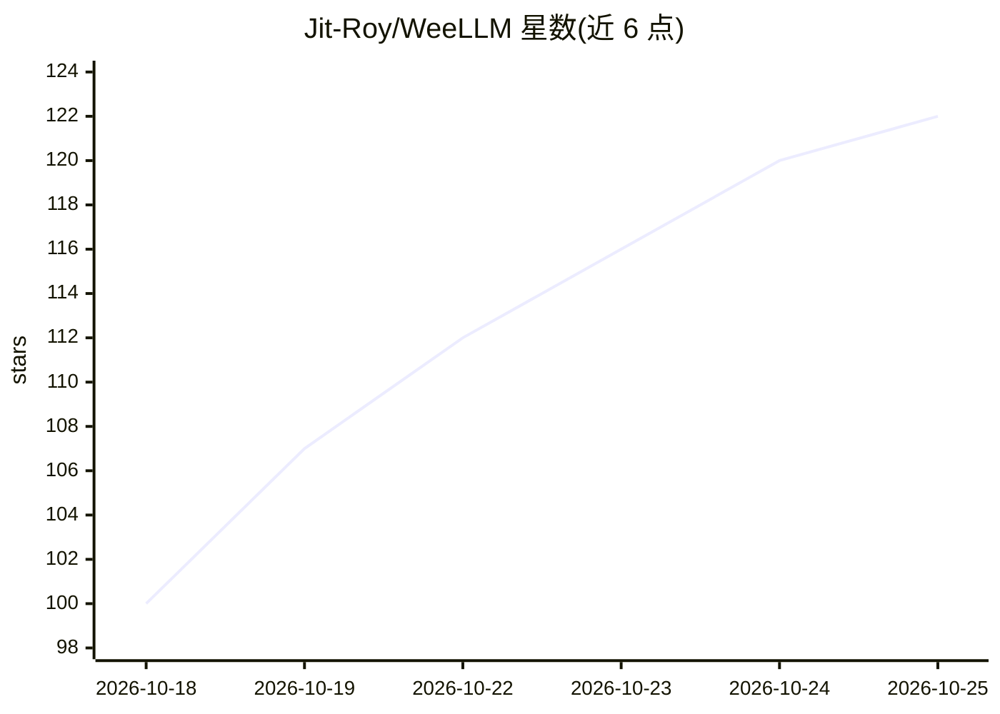

# Jit-Roy/WeeLLM

⭐ 122 · Python · 推送 2026-10-24 · [GitHub](https://github.com/Jit-Roy/WeeLLM) · 个人维护

**低显存运行大型扩散模型的分层流式推理工具**

面向显存受限硬件（最低 4GB VRAM）的扩散模型推理工具：动态测定可驻留显存的层数，将文本编码器与 transformer 其余层从 NVMe SSD 逐层流式传入 GPU，以不量化（bfloat16）方式运行 FLUX、SD3.5、Qwen-Image、ERNIE-Image、HiDream 等数十种文生图/图生图/视频模型。提供 CLI（可传 Hugging Face 模型 ID 与显存/内存预算）、Python API 与官方 ComfyUI 扩展；支持 GGUF 量化权重流式反量化。限制：云端实例因磁盘 I/O 受限会变慢；稠密自回归文生图模型（如 GLM-Image）不量化流式在实践上不可行。

## 筛选速览

| 维度 | 判定 | 备注 |
|---|---|---|
| AI 角色 | `ai-native` | 本体是模型或模型工具 |
| 许可风险 | `none` | — |
| 部署形态 | `library` | 以包/库形式分发 |
| 模型依赖 | local-ok | 支持本地模型 |
| 硬件要求 | `gpu-8g` | |
| 安装摩擦 | `low` | 无编译、无系统依赖或容器化 |
| 成熟度 | — | 结构信号不足 |

## 能力要点

- 逐层流式加载使大模型在低至 4GB VRAM 下运行，无需量化
- 支持 30+ 图像生成、图像编辑与视频生成模型（FLUX 系列、Qwen-Image、ERNIE-Image、HiDream 等）
- 提供 CLI、Python API 与官方 ComfyUI Custom Node 扩展
- 支持 GGUF 量化权重边流式边反量化

## 适用场景

- 在低显存显卡（如 RTX 3050）上本地运行 FLUX/Qwen-Image 等大模型
- 通过 ComfyUI 工作流使用低显存流式推理
- 磁盘空间或内存受限时以 GGUF 权重运行扩散模型

## 场景标签

`图像生成` `视频生成` `推理引擎` · 领域:内容生成

## 证据(README 行号)

> L11: # Layer-streaming inference for large diffusion models — Under 4 GB VRAM, no quantization
> L13: WeeLLM dynamically streams text encoder and transformer layers to the GPU for massive models. Instead of forcing th
> L154: from weellm import WeeTextToImagePipeline

## 星数曲线

2026-10-18 100 → 2026-10-25 122（+22）

---
*卡片 v1 · prompt 1.4 · 生成 2026-10-23 · 置信度 high · 依据 README sha `157b0faa55d9` · [字段定义](../../DATASET.md)*
