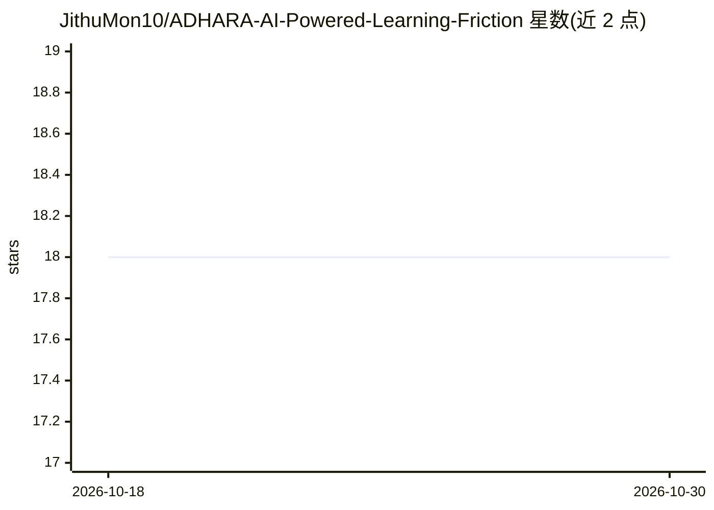

# JithuMon10/ADHARA-AI-Powered-Learning-Friction

⭐ 18 · JavaScript · 推送 2026-01-26 · [GitHub](https://github.com/JithuMon10/ADHARA-AI-Powered-Learning-Friction) · 组织维护

**多模态行为分析的学习障碍早期预警系统原型**

面向教育者与家长的早期预警系统原型：在儿童答题过程中采集视觉（视线/眨眼）、情绪（TensorFlow.js 微表情）、鼠标动态（犹豫/抖动）与语音（Web Speech API）四路行为信号，生成分数、摩擦指数等结果；分析报告环节由本地 Ollama 运行的 Qwen 2.5 7B 生成，应用无 Ollama 仍可运行但分析页被禁用。技术栈为 React + Vite 前端，全部处理本地进行。注意 README 自称 prototype，且仅提供源码运行方式。

## 筛选速览

| 维度 | 判定 | 备注 |
|---|---|---|
| AI 角色 | `ai-native` | 本体是模型或模型工具 |
| 许可风险 | `none` | — |
| 部署形态 | `library` | 以包/库形式分发 |
| 模型依赖 | local-ok | 支持本地模型 |
| 硬件要求 | — | 无带数字的原话,不猜 |
| 安装摩擦 | `low` | 无编译、无系统依赖或容器化 |
| 成熟度 | — | 结构信号不足 |

## 能力要点

- 四路多模态行为流采集（视觉/情绪/鼠标/语音）
- 题目随表现实时调整的自适应学习会话
- 本地 Ollama + Qwen 2.5 7B 生成临床分析报告
- 全部处理在本地进行，数据不出机器

## 适用场景

- 学校对读写障碍、计算障碍、ADHD 做早期筛查
- 特殊教育中做进展监测与干预计划参考
- 研究者采集学习行为数据用于认知研究
- 家长在家观察孩子的学习模式

## 场景标签

`多模态` · 领域:感知与多模态

## 证据(README 行号)

> L13: **ADHARA** (AI-Driven Holistic Assessment for Developmental Recognition and Assistance) is an intelligent early war
> L20: - 👁️ **Face & Emotion Analysis** - Detects stress, confusion, and engagement through webcam
> L23: - 📊 **AI-Powered Reports** - Generates clinical-grade analysis using local LLM (Ollama)

## 星数曲线

2026-10-18 18 → 2026-10-30 18（+0）

---
*卡片 v1 · prompt 1.4 · 生成 2026-10-29 · 置信度 high · 依据 README sha `2cadb50e920b` · [字段定义](../../DATASET.md)*
