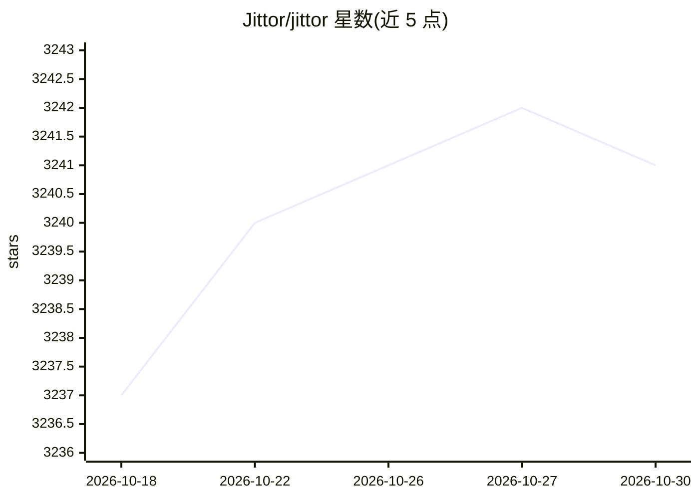

# Jittor/jittor

⭐ 3,241 · Python · Apache-2.0 · 推送 2026-10-29 · [GitHub](https://github.com/Jittor/jittor) · [官网](https://cg.cs.tsinghua.edu.cn/jittor/) · 组织维护 · 中文 README

**基于 JIT 编译与元算子的深度学习框架，面向研究者与开发者**

清华大学 CSCG 团队维护的深度学习框架：前端为 Python，采用动态图执行与模块化设计；后端由 CUDA、C++ 等高性能语言实现，整个框架与元算子在运行时即时编译（JIT），内置算子编译器与调优器。附论文（Hu et al. 2020），采用 Apache 2.0 许可。支持 Linux（含国产系统如 UOS/麒麟、龙芯/飞腾架构）与 Windows，GPU 支持 Nvidia CUDA、AMD ROCm 与海光 DCU（可选项）。提供 pip、Docker 与手动编译三种安装方式。

## 筛选速览

| 维度 | 判定 | 备注 |
|---|---|---|
| AI 角色 | `ai-ecosystem` | LLM/agent 周边工具 |
| 许可风险 | `permissive` | Apache-2.0 |
| 部署形态 | `self-host` | docker 或自建部署 |
| 模型依赖 | — | README 未给出锁定关系 |
| 硬件要求 | — | 无带数字的原话,不猜 |
| 安装摩擦 | `low` | 无编译、无系统依赖或容器化 |
| 成熟度 | — | 结构信号不足 |

## 能力要点

- 框架整体与元算子 JIT 即时编译，内置算子编译器与调优器
- 前端 Python 动态图，后端 CUDA/C++ 实现
- 覆盖图像识别、检测、分割、生成、可微渲染、几何学习、强化学习等模型库
- 支持 Nvidia CUDA、AMD ROCm、海光 DCU 及龙芯等 CPU 架构

## 适用场景

- 用 Python 定义并训练神经网络模型
- 研究 JIT 编译与元算子机制下的深度学习执行
- 在国产硬件（龙芯/海光 DCU/麒麟/UOS）环境运行深度学习任务
- 用 C++/CUDA 编写并 JIT 编译自定义算子

## 场景标签

`模型训练` · 领域:训练与推理

## 证据(README 行号)

> L7: Jittor is a high-performance deep learning framework based on JIT compiling and meta-operators. The whole framework 
> L9: The front-end language is Python. Module Design and Dynamic Graph Execution is used in the front-end, which is the m

## 星数曲线

2026-10-18 3,237 → 2026-10-30 3,241（+4）

---
*卡片 v1 · prompt 1.4 · 生成 2026-10-20 · 置信度 high · 依据 README sha `61b34ed5bd1f` · [字段定义](../../DATASET.md)*
