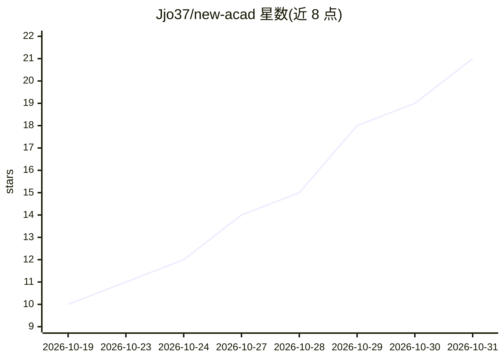

# Jjo37/new-acad

⭐ 21 · C# · MIT · 推送 2026-10-29 · [GitHub](https://github.com/Jjo37/new-acad) · 个人维护 · 中文 README

**装进 AutoCAD/Civil 3D 的自然语言 AI 工程助手插件**

由 C# 插件（进程内 TCP JSON-RPC）、内嵌面板与 relay、MCP 服务器三部分组成，把自然语言指令转成 AutoCAD/Civil 3D API 调用：绘图、三维建模、曲面/路线/廊道/管网等 C3D 专业操作、位图描摹成 CAD、文件通道与用户知识库。内置 Agent 对模型只暴露 2 个工具，由工程判断层在 423 个方法与 274 个 MCP 工具间路由。默认 LLM 模式填自己的 API Key 即可运行，需 Windows 与 AutoCAD 2025/2026。

## 筛选速览

| 维度 | 判定 | 备注 |
|---|---|---|
| AI 角色 | `ai-native` | 本体是模型或模型工具 |
| 许可风险 | `permissive` | MIT |
| 部署形态 | `desktop` | 安装包/桌面程序 |
| 模型依赖 | locked-api |  |
| 硬件要求 | — | 无带数字的原话,不猜 |
| 安装摩擦 | `medium` | 含编译或系统依赖之一 |
| 成熟度 | — | 结构信号不足 |

## 能力要点

- 内置 Agent 只暴露 2 个工具，路由至 423 个插件方法与 274 个 MCP 工具
- 覆盖 Civil 3D 专业域：曲面、路线、廊道、放坡、管网、土方计算
- 位图→CAD 描摹与图纸尺寸分诊（v1.6.0）
- 决策链可验证：结构化日志、回放对比、dry-run 工作流记录

## 适用场景

- 用自然语言批量编辑图元、绘制与建模
- 土木设计中创建廊道、放坡优化与土方平衡计算
- 把扫描图纸或图片描成 CAD 矢量线条
- 将规范文档放入知识库供 AI 引用

## 场景标签

 · 领域:土木工程/CAD 自动化

## 证据(README 行号)

> L3: > AutoCAD / Civil 3D 里的**内置 AI 工程助手**：自带大脑、直连 CAD，用户只需要一个自己的模型 Key
> L9: 不是"给 AI 加一堆 CAD 工具"，而是**把一个懂 C3D 工程实践的 Agent 装进 CAD 里**。
> L10: 内置 Agent 对模型**只暴露 2 个工具**（调插件、调 MCP）—— **423 个 CAD 方法一个都不直接丢给模型**，由一层工程判断决定"这个任务该走哪条通道"。

## 星数曲线

2026-10-19 10 → 2026-10-31 21（+11）

---
*卡片 v1 · prompt 1.4 · 生成 2026-10-29 · 置信度 high · 依据 README sha `f9aecdf41696` · [字段定义](../../DATASET.md)*
