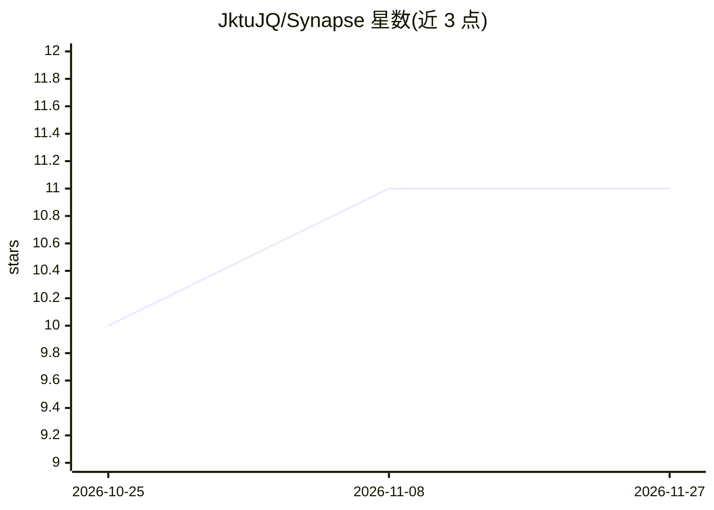

# JktuJQ/Synapse

⭐ 11 · Haskell · MIT · 推送 2026-11-26 · [GitHub](https://github.com/JktuJQ/Synapse) · 个人维护

**纯 Haskell 的机器学习库：构建与训练神经网络**

用纯 Haskell 编写的机器学习库，内置矩阵运算、反向模式动态自动微分系统与神经网络构件。API 设计参照 Python Keras，提供 Activation/Loss/Metric/Optimizer 等抽象与 SequentialModel 顺序模型构建、训练回调系统。支持用户通过定义 Symbol 函数扩展新运算、新层与新优化器。README 注明正在为 2.0 架构重写，1.x 代码在 v1 分支归档，性能优化仍在计划中。

## 筛选速览

| 维度 | 判定 | 备注 |
|---|---|---|
| AI 角色 | `ai-native` | 本体是模型或模型工具 |
| 许可风险 | `permissive` | MIT |
| 部署形态 | `None` |  |
| 模型依赖 | — | README 未给出锁定关系 |
| 硬件要求 | — | 无带数字的原话,不猜 |
| 安装摩擦 | `low` | 无编译、无系统依赖或容器化 |
| 成熟度 | `idea` | |

## 能力要点

- 内置矩阵类型与反向模式动态自动微分系统
- 参照 Keras API 的层/模型/优化器/回调接口
- 通过 typeclass 支持扩展新运算、层与优化器
- 自带 Vec/Mat 张量实现，不依赖外部数值库

## 适用场景

- 在 Haskell 项目中构建与训练神经网络
- 需要可扩展自动微分机制时定义自定义符号运算
- 学习研究自动微分与层系统的函数式实现

## 场景标签

 · 领域:机器学习/开发库

## 证据(README 行号)

> L8: `Synapse` is a machine learning library written in pure Haskell,
> L34: autodifferentiation system,
> L104: `Synapse` takes as much of Keras API as it is possible, but is also provides additional abstractions leveraging Ha

## 星数曲线

2026-10-25 10 → 2026-11-27 11（+1）

---
*卡片 v1 · prompt 1.4 · 生成 2026-11-19 · 置信度 high · 依据 README sha `05780cae21d2` · [字段定义](../../DATASET.md)*
