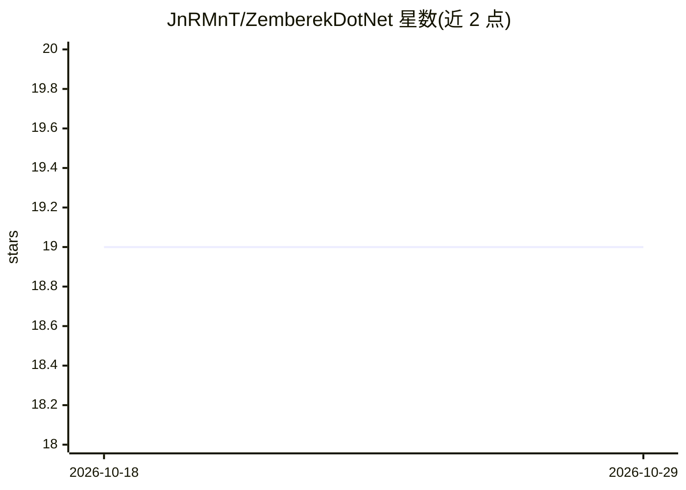

# JnRMnT/ZemberekDotNet

⭐ 19 · C# · Apache-2.0 · 推送 2026-04-13 · [GitHub](https://github.com/JnRMnT/ZemberekDotNet) · 个人维护

**面向 .NET 的土耳其语 NLP 库：形态分析/分词/NER/拼写检查**

Zemberek-NLP（Java 土耳其语 NLP 工具库）的 C#/.NET 移植，已演化为独立维护的库：保持原模块结构与核心算法，同时加入 .NET 特有改进（交互动词形态、撇号分词、ANTLR 4.13.1）。以 NuGet 包形式分发（netstandard2.1，.NET Core 3.0+/.NET 5-8 可用），模块覆盖形态分析与消歧、分词与句子切分、拼写检查与噪声文本规范化、命名实体识别、fastText 文本分类、语言识别、语言模型压缩，并提供 CLI 工具与多个示例工程。gRPC 服务模块暂缓未实现，不支持 .NET Framework。

## 筛选速览

| 维度 | 判定 | 备注 |
|---|---|---|
| AI 角色 | `ai-native` | 本体是模型或模型工具 |
| 许可风险 | `permissive` | Apache-2.0 |
| 部署形态 | `None` |  |
| 模型依赖 | — | README 未给出锁定关系 |
| 硬件要求 | — | 无带数字的原话,不猜 |
| 安装摩擦 | `medium` | 含编译或系统依赖之一 |
| 成熟度 | — | 结构信号不足 |

## 能力要点

- 土耳其语形态学分析、消歧与词形生成
- fastText 文本分类与语言识别（含混语句子扫描）
- 土耳其语拼写检查、词建议与噪声文本规范化
- 命名实体识别（PERSON/LOCATION/ORGANIZATION）与端到端 Pipeline 示例

## 适用场景

- 在 .NET 项目中做土耳其语形态分析与词元提取
- 对土耳其语文本做拼写检查与规范化
- 构建 Tokenization→Morphology→LangID 的端到端处理管线

## 场景标签

 · 领域:自然语言处理

## 证据(README 行号)

> L10: ZemberekDotNet started as a C#/.NET port of Zemberek-NLP (Natural Language Processing tools for Turkish) and has si
> L51: |Morphology|ZemberekDotNet.Morphology|Turkish morphological analysis, disambiguation and word generation.|NuGet NuG

## 星数曲线

2026-10-18 19 → 2026-10-29 19（+0）

---
*卡片 v1 · prompt 1.4 · 生成 2026-10-29 · 置信度 high · 依据 README sha `b71a54499ff4` · [字段定义](../../DATASET.md)*
