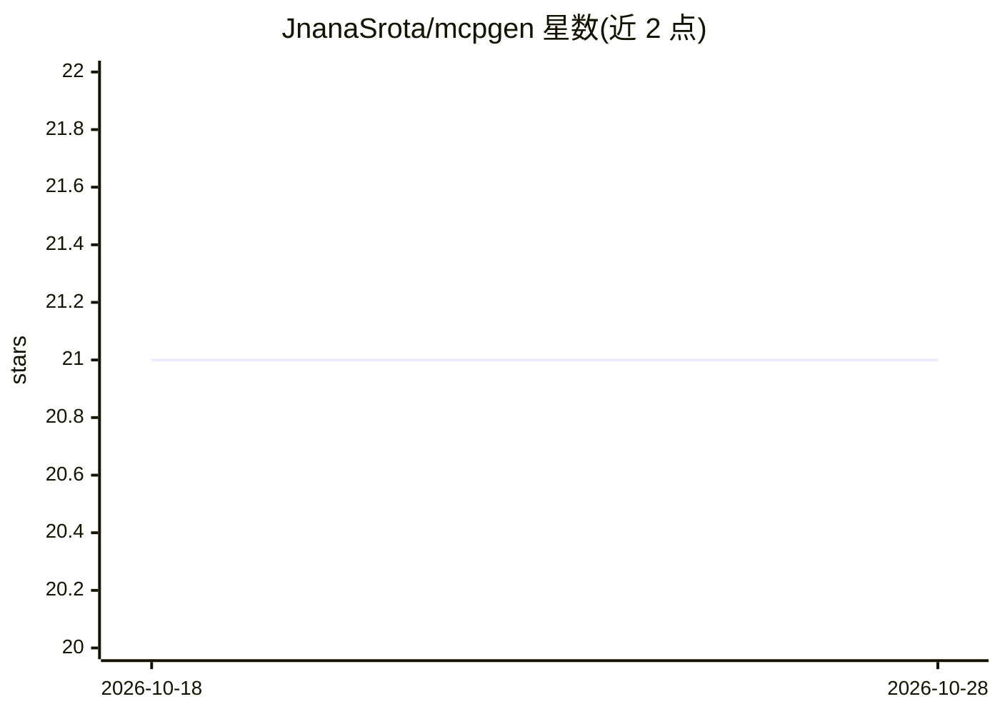

# JnanaSrota/mcpgen

⭐ 21 · Python · MIT · 推送 2026-06-30 · [GitHub](https://github.com/JnanaSrota/mcpgen) · 个人维护

**把 OpenAPI/Postman 规格生成为可自持的 Python MCP 服务器代码**

命令行工具 mcpgen 读取 OpenAPI 3.x（JSON/YAML/URL）或 Postman Collection v2.1，输出一个自包含的 Python MCP 服务器源码目录（server.py + requirements.txt），生成后不依赖 mcpgen 运行，可修改鉴权、部署到任意位置并纳入版本管理。自动从规格中识别 Bearer/API Key/Basic 鉴权方案并生成对应环境变量，OAuth2 以 bearer token 方式近似处理；另打印可直接粘贴到 Claude Desktop 配置的片段。以 pip 包与 CLI 形式提供，MIT 许可且生成代码归使用者所有。

## 筛选速览

| 维度 | 判定 | 备注 |
|---|---|---|
| AI 角色 | `ai-ecosystem` | LLM/agent 周边工具 |
| 许可风险 | `permissive` | MIT |
| 部署形态 | `library` | 以包/库形式分发 |
| 模型依赖 | — | README 未给出锁定关系 |
| 硬件要求 | — | 无带数字的原话,不猜 |
| 安装摩擦 | `low` | 无编译、无系统依赖或容器化 |
| 成熟度 | — | 结构信号不足 |

## 能力要点

- 读取 OpenAPI 3.x JSON/YAML/URL 与 Postman Collection v2.1 生成 MCP 服务器
- 输出自包含 Python 源码，运行时不依赖 mcpgen，无代理
- 自动识别 Bearer/API Key/Basic 鉴权并生成环境变量
- 打印 Claude Desktop 配置片段

## 适用场景

- 把现有 REST API 快速包装成 MCP 工具供 Claude 调用
- 审查并自定义生成后的鉴权、重试与错误处理逻辑
- 将 API 工具服务纳入自己的仓库做版本管理

## 场景标签

`代码生成` · 领域:编码与开发

## 证据(README 行号)

> L14: Point `mcpgen` at an OpenAPI spec or Postman collection. Get back a **complete Python MCP server you own** — no run
> L89: `mcpgen` is a build tool. Needed once, at generation time. Never at runtime.

## 星数曲线

2026-10-18 21 → 2026-10-28 21（+0）

---
*卡片 v1 · prompt 1.4 · 生成 2026-10-28 · 置信度 high · 依据 README sha `aeb938976cdb` · [字段定义](../../DATASET.md)*
