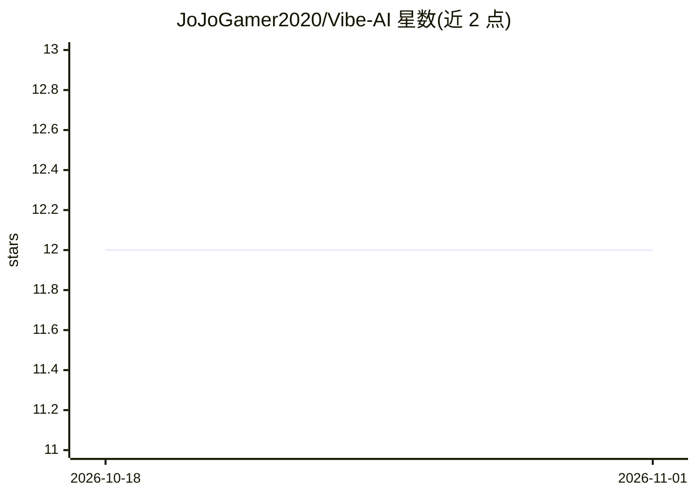

# JoJoGamer2020/Vibe-AI

⭐ 12 · HTML · MIT · 推送 2026-07-23 · [GitHub](https://github.com/JoJoGamer2020/Vibe-AI) · [官网](https://jojogamer2020.github.io/Vibe-AI/) · 个人维护

**单文件网页聊天客户端，连接任意 OpenAI 兼容 API**

一个纯 HTML/CSS/JavaScript 的单文件聊天前端，通过标准 /models 与 /chat/completions 端点连接任意 OpenAI 兼容后端（如 OpenAI、Ollama、LM Studio、Groq 等）。零安装、零构建：下载 index.html 后在浏览器打开即可使用。功能包括动态拉取模型列表、系统提示词、图片上传的多模态视觉对话、消息内联编辑、重新生成与中断请求，数据（含 API key 与聊天记录）仅存于浏览器 LocalStorage。MIT 许可。

## 筛选速览

| 维度 | 判定 | 备注 |
|---|---|---|
| AI 角色 | `ai-ecosystem` | LLM/agent 周边工具 |
| 许可风险 | `permissive` | MIT |
| 部署形态 | `None` |  |
| 模型依赖 | — | README 未给出锁定关系 |
| 硬件要求 | — | 无带数字的原话,不猜 |
| 安装摩擦 | `low` | 无编译、无系统依赖或容器化 |
| 成熟度 | — | 结构信号不足 |

## 能力要点

- 单文件 index.html，无安装与构建步骤
- 连接任意 OpenAI 兼容 API（/models 与 /chat/completions）
- 内联编辑、重新生成、可取消请求
- 图片上传与视觉模型对话

## 适用场景

- 为本地 Ollama/LM Studio 模型配一个即开即用的聊天界面
- 不想安装应用、直接在浏览器里对接云端 LLM API
- 需要可内联编辑消息、调试提示词的轻量对话前端

## 场景标签

`聊天机器人` · 领域:对话与助手

## 证据(README 行号)

> L7: **Vibe AI** is a sleek, lightning-fast, single-file web interface for interacting with any standard OpenAI-compatibl
> L14: * **Bring Your Own API:** Connect seamlessly to any backend that supports standard `/models` and `/chat/completions
> L41: * An active API endpoint (e.g., OpenAI, Ollama, LM Studio, Groq, Anthropic via proxy, etc.).

## 星数曲线

2026-10-18 12 → 2026-11-01 12（+0）

---
*卡片 v1 · prompt 1.4 · 生成 2026-11-01 · 置信度 high · 依据 README sha `545d98edada8` · [字段定义](../../DATASET.md)*
