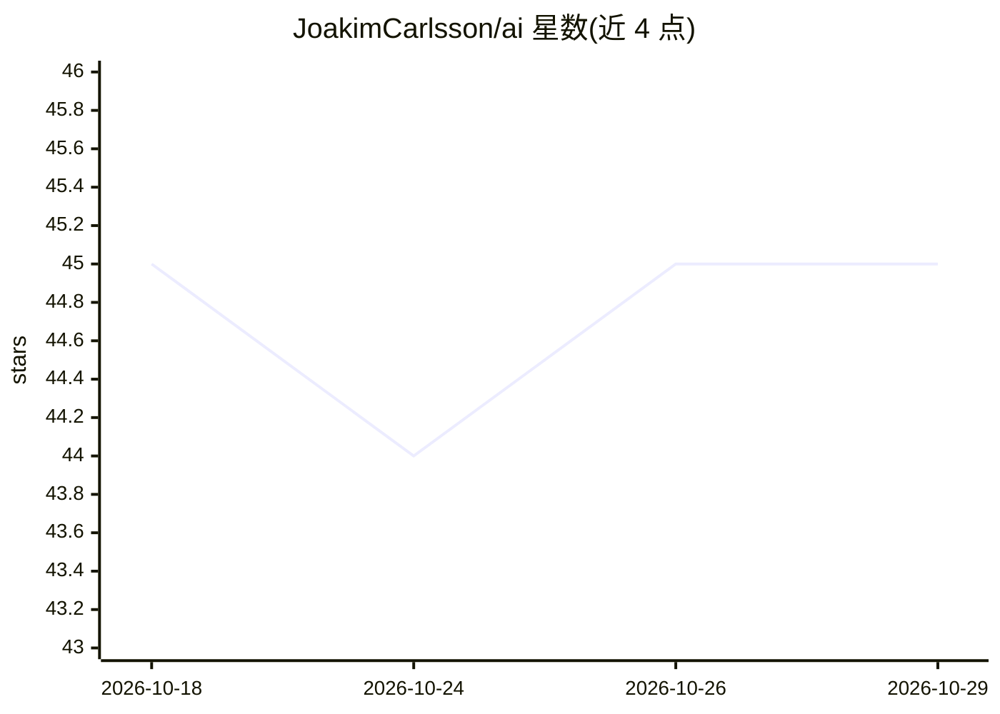

# JoakimCarlsson/ai

⭐ 45 · Go · MIT · 推送 2026-10-28 · [GitHub](https://github.com/JoakimCarlsson/ai) · 个人维护

**Go 多厂商 AI 工具库：统一 LLM 客户端与 agent 框架**

面向 Go 开发者的多厂商 AI 库，覆盖 LLM 对话/流式/工具调用/结构化输出、embeddings、图像生成、TTS/STT、rerankers 与代码填充。按约 50 个独立 Go 模块组织，按能力分层（接口/厂商实现/agent 运行时/持久化），只导入所需 SDK。含 agent 框架（子 agent、handoff、会话、持久记忆）与低延迟语音 agent 管线，支持 MCP 集成、OpenTelemetry 追踪与成本统计。各模块独立用路径前缀 tag 版本化。

## 筛选速览

| 维度 | 判定 | 备注 |
|---|---|---|
| AI 角色 | `ai-ecosystem` | LLM/agent 周边工具 |
| 许可风险 | `permissive` | MIT |
| 部署形态 | `None` |  |
| 模型依赖 | locked-api |  |
| 硬件要求 | — | 无带数字的原话,不猜 |
| 安装摩擦 | `low` | 无编译、无系统依赖或容器化 |
| 成熟度 | — | 结构信号不足 |

## 能力要点

- 多厂商统一接口：LLM/embeddings/图像/TTS/STT/rerankers/FIM，另支持任意 OpenAI 兼容端点（BYOM）
- agent 框架：子 agent、handoffs、fan-out、会话、持久记忆、上下文策略
- 流式 STT→LLM→TTS 语音 agent 管线，支持 barge-in 与可插拔厂商
- 按模块化分发，仅导入所用 SDK，无传递依赖膨胀

## 适用场景

- 在 Go 服务中统一接入 OpenAI/Anthropic/Gemini 等多家厂商
- 构建带子 agent 与 handoff 的多 agent 应用
- 开发低延迟实时语音对话 agent
- 对 LLM 调用做批量处理、追踪与成本核算

## 场景标签

`Agent 框架` `多智能体` `模型网关` · 领域:Agent 开发

## 证据(README 行号)

> L9: A multi-provider Go library for AI: LLMs, embeddings, image generation, TTS,
> L20: - **Agent framework** — Sub-agents, handoffs, fan-out, sessions, persistent memory, context strategies
> L64: ## Supported providers

## 星数曲线

2026-10-18 45 → 2026-10-29 45（+0）

---
*卡片 v1 · prompt 1.4 · 生成 2026-10-25 · 置信度 high · 依据 README sha `5277f574c857` · [字段定义](../../DATASET.md)*
