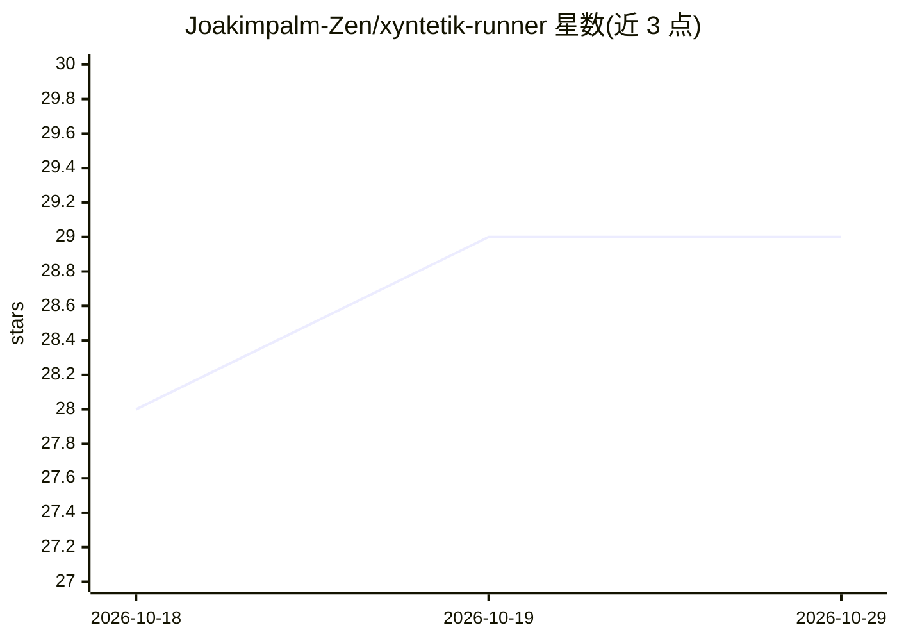

# Joakimpalm-Zen/xyntetik-runner

⭐ 29 · C · Apache-2.0 · 推送 2026-10-28 · [GitHub](https://github.com/Joakimpalm-Zen/xyntetik-runner) · [官网](https://xyntetik.com) · 个人维护

**单二进制 C 语言本地 GGUF 推理引擎：可验证的推理、量化与 LoRA 训练**

用纯 C 从零编写的单文件本地推理引擎：读取标准 GGUF 模型，在 CPU/CUDA/Apple Metal 上运行，提供 OpenAI 与 Anthropic 兼容的 HTTP API。功能包括：--fit 只读模型文件头几 MB 即判断是否能装进本机显存/内存；按 plan 选择性量化并测量与原模型的偏差；--kv 压缩上下文缓存；空闲时把模型内存交还操作系统；工具调用在 token 截断时仍返回可解析结果；并能在所服务的量化文件上直接训练 LoRA 适配器（无 Python 栈），两次训练逐字节一致，运行可签名重放。Apache 2.0 许可。

## 筛选速览

| 维度 | 判定 | 备注 |
|---|---|---|
| AI 角色 | `ai-ecosystem` | LLM/agent 周边工具 |
| 许可风险 | `permissive` | Apache-2.0 |
| 部署形态 | `None` |  |
| 模型依赖 | — | README 未给出锁定关系 |
| 硬件要求 | — | 无带数字的原话,不猜 |
| 安装摩擦 | `medium` | 含编译或系统依赖之一 |
| 成熟度 | — | 结构信号不足 |

## 能力要点

- --fit 读取模型文件前几 MB 预判 GPU/CPU 分层是否放得下
- 在所部署的量化权重上直接训练 LoRA，结果逐字节可复现
- 工具调用在 max_tokens 截断时仍返回可执行的完整调用
- 空闲内存交还 OS（63 GB 模型 idle 时占用 35 MB），OpenAI/Anthropic 兼容 API

## 适用场景

- 本地运行 GGUF 模型并接入现有 OpenAI/Anthropic 客户端
- 下载前判断大模型能否装进自己的机器
- 在消费级 GPU 上对量化模型做小数据集 LoRA 微调
- 长时间驻留的本地模型服务且不占满内存

## 场景标签

`推理引擎` `微调` `模型量化` · 领域:训练与推理

## 证据(README 行号)

> L44: - **Speaks what your tools speak.** Standard GGUF model files and the OpenAI
> L269: Runner trains a LoRA adapter through the quantized file you serve, in the
> L285: file you ship. Runner's serving forward pass is its training forward pass,

## 星数曲线

2026-10-18 28 → 2026-10-29 29（+1）

---
*卡片 v1 · prompt 1.4 · 生成 2026-10-26 · 置信度 high · 依据 README sha `f22ac5de4492` · [字段定义](../../DATASET.md)*
