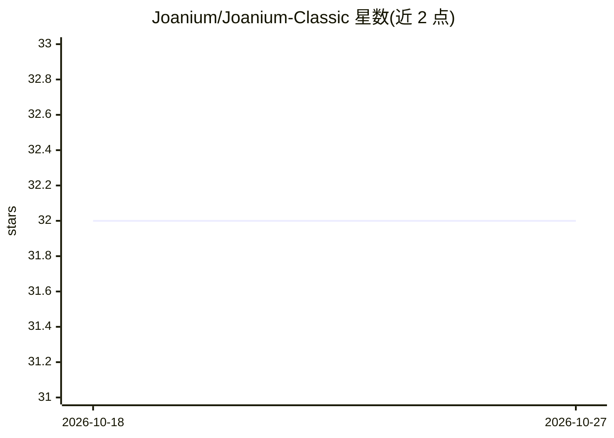

# Joanium/Joanium-Classic

⭐ 32 · JavaScript · NOASSERTION · 推送 2026-10-26 · [GitHub](https://github.com/Joanium/Joanium-Classic) · [官网](https://www.joanium.com) · 组织维护

**本地优先的 AI 桌面助手：多模型聊天、定时自动化与后台 agent**

基于 Electron/Node.js 的本地优先 AI 桌面应用：加载用户项目文件、读取上下文、运行终端命令的多模型聊天；支持定时自动化任务（内置 RSS/Reddit/GitHub 等数据源与通知/Slack/邮件等输出）、后台 agent、Personas 与 Skills 文件、GitHub/Gmail/Drive 等集成及 MCP 协议。支持 10+ AI 提供商，可配合 Ollama/LM Studio 完全离线使用。通过官网下载安装（Windows/macOS/Linux），开发者可从源码运行。采用 PolyForm Noncommercial 许可，禁止商业使用。

## 筛选速览

| 维度 | 判定 | 备注 |
|---|---|---|
| AI 角色 | `ai-native` | 本体是模型或模型工具 |
| 许可风险 | `none` | NOASSERTION |
| 部署形态 | `library` | 以包/库形式分发 |
| 模型依赖 | local-ok | 支持本地模型 |
| 硬件要求 | — | 无带数字的原话,不猜 |
| 安装摩擦 | `low` | 无编译、无系统依赖或容器化 |
| 成熟度 | — | 结构信号不足 |

## 能力要点

- 多模型聊天，支持 10+ 提供商且可中途切换
- 定时自动化与后台 agent（可调度任意模型、任意项目）
- GitHub/Gmail/Drive 等原生集成与 MCP 协议支持
- Skills/Personas 为可编辑、可版本控制的普通文件

## 适用场景

- 在桌面端用本地文件上下文与任意 AI 模型对话
- 设置定时任务自动汇总 GitHub issues 并推送通知
- 配合 Ollama/LM Studio 实现完全本地离线的 AI 助手

## 场景标签

`AI 助手` `工作流自动化` · 领域:效率与自动化

## 证据(README 行号)

> L23: > **Joanium Classic** is a local-first AI desktop app that goes far beyond a chat window. It knows your projects an
> L6:  Multi-model chat · Scheduled automations · Background agents · MCP · Real integrations

## 星数曲线

2026-10-18 32 → 2026-10-27 32（+0）

---
*卡片 v1 · prompt 1.4 · 生成 2026-10-26 · 置信度 mid · 依据 README sha `9219c9a96e21` · [字段定义](../../DATASET.md)*
