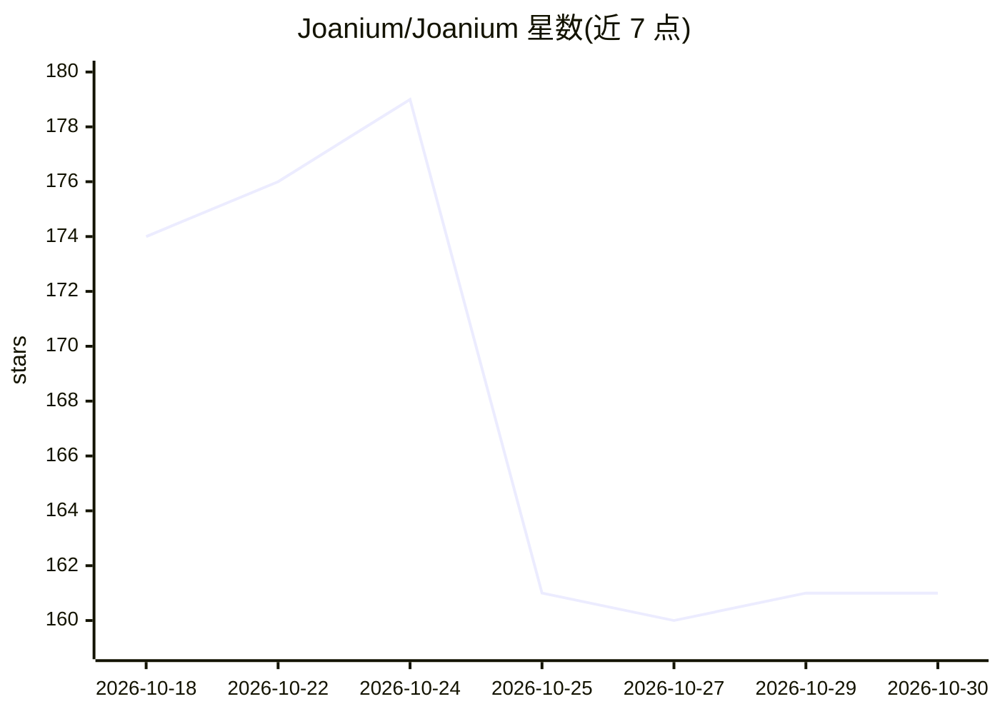

# Joanium/Joanium

⭐ 161 · JavaScript · NOASSERTION · 推送 2026-10-29 · [GitHub](https://github.com/Joanium/Joanium) · [官网](https://www.joanium.com) · 组织维护

**本地优先的 AI 桌面助手：多模型对话与定时后台 Agent**

基于 Electron/Node.js 的本地优先 AI 桌面代理应用：提供多模型聊天（10+ 提供商，含 Ollama/LM Studio 离线运行）、定时后台 Agent、Telegram/Slack/Discord 等消息渠道接入、GitHub/Gmail/Drive 等集成、MCP 支持、人设与技能系统、长期记忆与项目工作区。数据存储在本机 Data/ 目录，可完全离线运行。技能与人设预装并附社区 Marketplace。许可证为 PolyForm Noncommercial 1.0.0（禁止商用），通过下载安装包安装。

## 筛选速览

| 维度 | 判定 | 备注 |
|---|---|---|
| AI 角色 | `ai-native` | 本体是模型或模型工具 |
| 许可风险 | `none` | NOASSERTION |
| 部署形态 | `None` |  |
| 模型依赖 | local-ok | 支持本地模型 |
| 硬件要求 | — | 无带数字的原话,不猜 |
| 安装摩擦 | `low` | 无编译、无系统依赖或容器化 |
| 成熟度 | — | 结构信号不足 |

## 能力要点

- 10+ 模型提供商接入，含 Ollama/LM Studio 完全离线模式
- 定时运行的后台 Agent（代码审查、PR 摘要等）
- MCP 兼容服务器接入与技能/人设系统
- Telegram/WhatsApp/Discord/Slack 等消息渠道回复

## 适用场景

- 每天定时用 AI 汇总 GitHub issues 并推送到 Slack
- 在本机离线运行模型处理自己的文件与代码库
- 通过 Telegram/Slack 等聊天工具随时调用 AI 助手

## 场景标签

`AI 助手` `聊天机器人` `工作流自动化` · 领域:效率与自动化

## 证据(README 行号)

> L27: **Joanium is a local-first AI desktop agent that actually *does* stuff** — not just talks about doing stuff.
> L46: Switch between Gemini, Claude, GPT, Grok, Mistral, or go fully offline with Ollama / LM Studio. 10+ providers. Use 

## 星数曲线

2026-10-18 174 → 2026-10-30 161（-13）

---
*卡片 v1 · prompt 1.4 · 生成 2026-10-22 · 置信度 high · 依据 README sha `54affc31cce7` · [字段定义](../../DATASET.md)*
