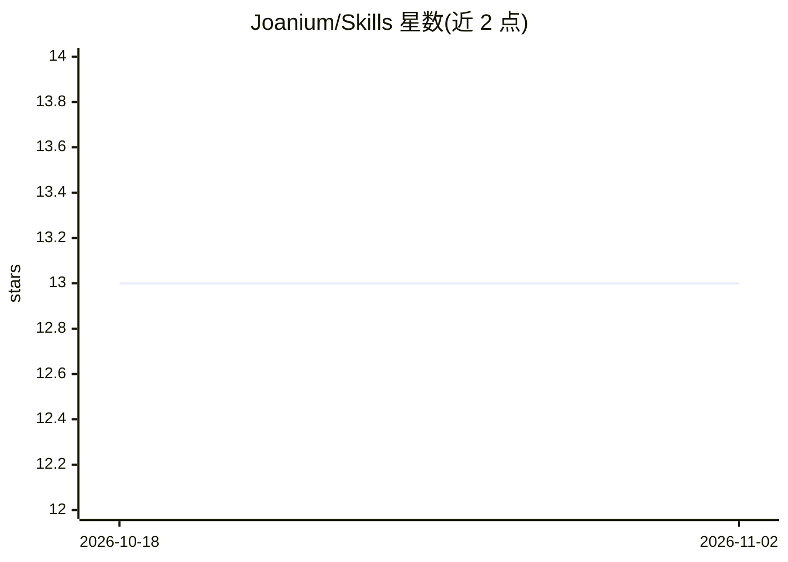

# Joanium/Skills

⭐ 13 · Apache-2.0 · 推送 2026-05-17 · [GitHub](https://github.com/Joanium/Skills) · [官网](https://www.joanium.com/marketplace) · 个人维护

**Joanium 桌面助手的可复用技能仓库，聚合开发与自动化技能**

Joanium Skills 是围绕 Joanium 桌面 AI 助手构建的大规模技能仓库，定位为可复用、实用技能的中心库，涵盖开发者工具、AI agent 动作、自动化工作流、API 集成、生产力工具、数据处理与创作者工作流等类别。面向开发者、创作者等构建者，通过 GitHub 仓库与 Joanium Marketplace 网站浏览技能，接受社区贡献。README 未给出技能的安装命令或具体条目数量，MIT 许可。

## 筛选速览

| 维度 | 判定 | 备注 |
|---|---|---|
| AI 角色 | `ai-knowledge` | 知识聚合/清单类 |
| 许可风险 | `permissive` | Apache-2.0 |
| 部署形态 | `None` |  |
| 模型依赖 | — | README 未给出锁定关系 |
| 硬件要求 | — | 无带数字的原话,不猜 |
| 安装摩擦 | `low` | 无编译、无系统依赖或容器化 |
| 成熟度 | — | 结构信号不足 |

## 能力要点

- 技能类别覆盖开发者工具、AI agent 动作、自动化工作流、API 集成等
- 配套 Joanium Marketplace 网站可视化浏览
- 开放社区贡献技能

## 适用场景

- 为 Joanium 桌面助手查找可复用的自动化与 AI 技能
- 贡献自己的技能到 Joanium 生态
- 浏览各类生产力与数据处理技能

## 场景标签

`工作流自动化` · 领域:效率与自动化

## 证据(README 行号)

> L29: **Joanium Skills** is a large-scale skills repository built to help people move faster, build smarter, and unlock m
> L53: This repository is meant to hold a huge variety of skills, including:

## 星数曲线

2026-10-18 13 → 2026-11-02 13（+0）

---
*卡片 v1 · prompt 1.4 · 生成 2026-10-31 · 置信度 high · 依据 README sha `a9b1de6b2f70` · [字段定义](../../DATASET.md)*
