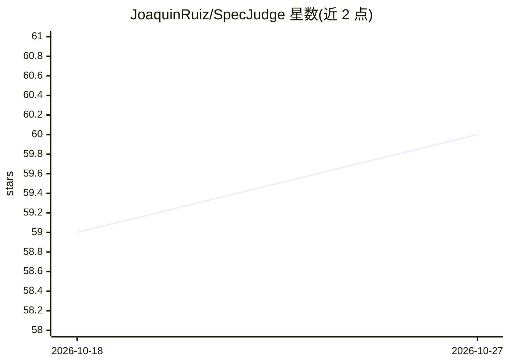

# JoaquinRuiz/SpecJudge

⭐ 60 · Python · MIT · 推送 2026-09-24 · [GitHub](https://github.com/JoaquinRuiz/SpecJudge) · [官网](https://jokiruiz.com) · 个人维护

**读取规格文档并推荐性价比最合适 AI 模型的本地 CLI**

面向采用 Spec-Driven Development 的开发者：在实现开始前，CLI 读取 spec-kit 工件、AGENTS.md/CLAUDE.md、编辑器规则与决策记录，由本地 Ollama 运行的 judge 模型评估项目各维度的需求强度，再与 models.yaml 目录中各模型声明的能力交叉比对，输出 good/overkill/fair/poor 评级与排名。judge 的评级必须引用规格中的真实片段，无法佐证的维度记为 unsupported 而非猜测。要求 Python 3.11+、uv 和 Ollama 0.5.0+，也支持 OpenAI 兼容端点（llama.cpp、vLLM 等）。

## 筛选速览

| 维度 | 判定 | 备注 |
|---|---|---|
| AI 角色 | `ai-ecosystem` | LLM/agent 周边工具 |
| 许可风险 | `permissive` | MIT |
| 部署形态 | `desktop` | 安装包/桌面程序 |
| 模型依赖 | local-ok | 支持本地模型 |
| 硬件要求 | — | 无带数字的原话,不猜 |
| 安装摩擦 | `low` | 无编译、无系统依赖或容器化 |
| 成熟度 | — | 结构信号不足 |

## 能力要点

- 从规格工件出发按需求强度为 37 个目录模型评级排名（含价格与开源信息）
- judge 评级须引用规格片段并核验其真实存在，未佐证维度不参与计算
- 输出预算包络（envelope），区分 single 与 escalating 两种实施模型策略
- 数据状态显式声明（Sufficient/Scarce/Insufficient），并支持 --json 脚本化输出

## 适用场景

- 规格写完后、动手实现前选一个够用不浪费的模型
- 在本地完成评估，避免规格内容或 API 调用费用外泄
- 决定任务集是用单一模型还是按任务升级模型来实施

## 场景标签

 · 领域:开发者工具/LLM 选型

## 证据(README 行号)

> L5: SpecJudge reads your Spec-Driven Development artifacts and tells you which AI model actually
> L50: Ollama 0.5.0+ with at least one local model. The version matters:
> L156: `rating-rules.yaml` cross that demand against each model's declared capability. The best **fit**

## 星数曲线

2026-10-18 59 → 2026-10-27 60（+1）

---
*卡片 v1 · prompt 1.4 · 生成 2026-10-24 · 置信度 high · 依据 README sha `d0669b005481` · [字段定义](../../DATASET.md)*
