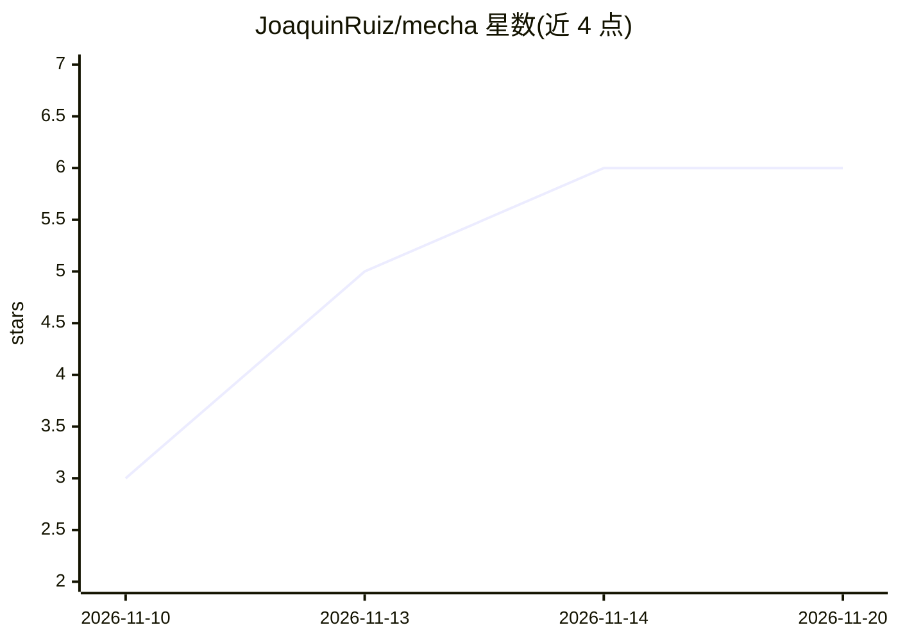

# JoaquinRuiz/mecha

⭐ 6 · Python · MIT · 推送 2026-11-12 · [GitHub](https://github.com/JoaquinRuiz/mecha) · [官网](https://joaquinruiz.github.io/mecha/) · 个人维护 · 中文 README

**本地仪表盘+CLI：检查 AI API 密钥的有效期与余额**

Mecha 是本地运行的 web + CLI 工具，对用户的 AI 凭证做状态检查：密钥是否有效、余额、过期时间与类型，覆盖 Anthropic、OpenAI、Gemini、xAI、OpenRouter 及 Codex/Claude Code/Gemini CLI 的会话文件。检查只用各厂商免费端点，消费 token 的主动探测需手动 opt-in 并先显示费用。密钥存于系统 keyring，加密存储且不回显；带 AES-256-GCM 加密备份、明文密钥扫描（mecha scan）与 Nagios 风格退出码。当前为 Alpha 版。

## 筛选速览

| 维度 | 判定 | 备注 |
|---|---|---|
| AI 角色 | `ai-ecosystem` | LLM/agent 周边工具 |
| 许可风险 | `permissive` | MIT |
| 部署形态 | `library` | 以包/库形式分发 |
| 模型依赖 | locked-api |  |
| 硬件要求 | — | 无带数字的原话,不猜 |
| 安装摩擦 | `low` | 无编译、无系统依赖或容器化 |
| 成熟度 | `idea` | |

## 能力要点

- 对 5 家厂商密钥校验有效性、余额与过期时间，仅用免费端点
- 扫描本机明文密钥（shell 历史、AI 工具配置）并脱敏列出
- AES-256-GCM 加密导出/合并备份，密钥存于系统 keyring
- 本地 web 仪表盘，CSP、会话 token 与 Host 校验防护

## 适用场景

- 检查手上多家的 API 密钥哪些还有效、快过期
- 扫描开发机找出散落在配置文件和历史里的明文密钥
- 脚本/CI 中用退出码批量校验密钥健康状态

## 场景标签

 · 领域:开发者工具/密钥管理

## 证据(README 行号)

> L22: Mecha is a local-first dashboard (web + CLI) that tells you at a glance how much life each of your AI credentials h
> L49: - **Local-first.** Runs on `127.0.0.1`. A key only ever leaves your machine towards its own provider's official end

## 星数曲线

2026-11-10 3 → 2026-11-20 6（+3）

---
*卡片 v1 · prompt 1.4 · 生成 2026-11-20 · 置信度 mid · 依据 README sha `4150b505343c` · [字段定义](../../DATASET.md)*
