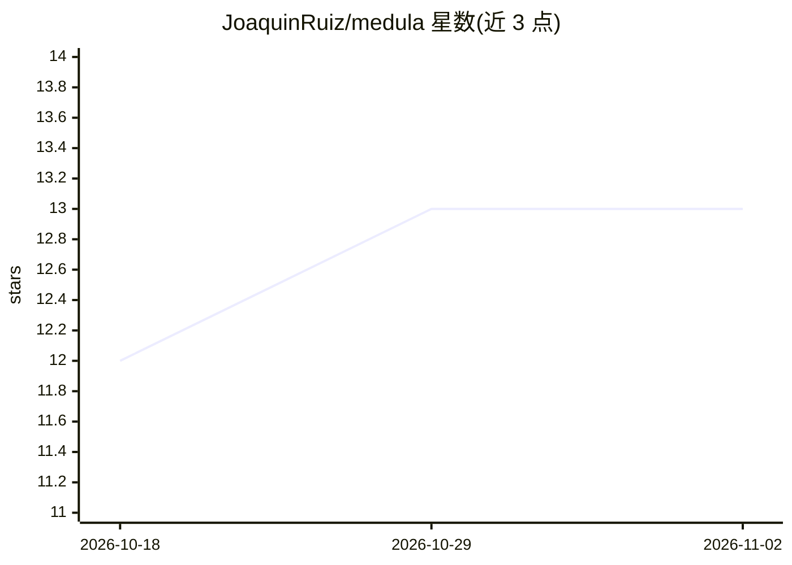

# JoaquinRuiz/medula

⭐ 13 · Python · MIT · 推送 2026-10-02 · [GitHub](https://github.com/JoaquinRuiz/medula) · [官网](https://www.youtube.com/watch?v=FIOXJXRfsZQ) · 个人维护

**多编码 agent 并发协作的协调内核与可复现评测实验室**

面向在同一仓库同时运行的多个编码 agent（Claude Code + claude-sonnet-5）：Médula 内核在每次写操作前通过 PreToolUse hook 询问快速判定器（Jev/Haiku/Sonnet 给出碰撞概率），不确定时升级到慢路径，决定谁等待谁。附带可复现实验室：6 个刻意制造语义冲突的任务、6 种协调模式（顺序/分支/文件锁/Médula 三种判定器），公开全部运行数据（agent 会话、diff、SQLite 决策记录）。测试无需 API key。限制：Jev 在真实写请求上 61% 决策落入不确定带；阈值与测量用同一校准集，无独立验证集。

## 筛选速览

| 维度 | 判定 | 备注 |
|---|---|---|
| AI 角色 | `ai-ecosystem` | LLM/agent 周边工具 |
| 许可风险 | `permissive` | MIT |
| 部署形态 | `None` |  |
| 模型依赖 | — | README 未给出锁定关系 |
| 硬件要求 | — | 无带数字的原话,不猜 |
| 安装摩擦 | `low` | 无编译、无系统依赖或容器化 |
| 成熟度 | — | 结构信号不足 |

## 能力要点

- 写操作前经 PreToolUse hook 询问概率型判定器决定阻塞或放行
- 6 任务 x 6 协调模式的对照实验，结果全量公开（SQLite 决策记录）
- 测试模拟模型提供方，无需 API key 即可运行
- 判定器接口可插拔（本地模型/其他 provider/静态分析器均可）

## 适用场景

- 多个编码 agent 同仓库并行开发时减少语义冲突与不必要阻塞
- 研究/测量多 agent 协调策略的成本与效果
- 为碰撞判定贡献新判定器、校准对或新冲突场景

## 场景标签

`多智能体` `模型评测` `Agent 框架` · 领域:Agent 开发

## 证据(README 行号)

> L5: A small, fully reproducible lab for measuring how coding agents coordinate, and **Médula**, a kernel
> L6: that coordinates them: before every write it asks a fast decider whether the change collides with
> L7: what the other agents are doing.
> L150: agent wants to Edit / Write / Bash

## 星数曲线

2026-10-18 12 → 2026-11-02 13（+1）

---
*卡片 v1 · prompt 1.4 · 生成 2026-10-31 · 置信度 high · 依据 README sha `301c9bb7cc3b` · [字段定义](../../DATASET.md)*
