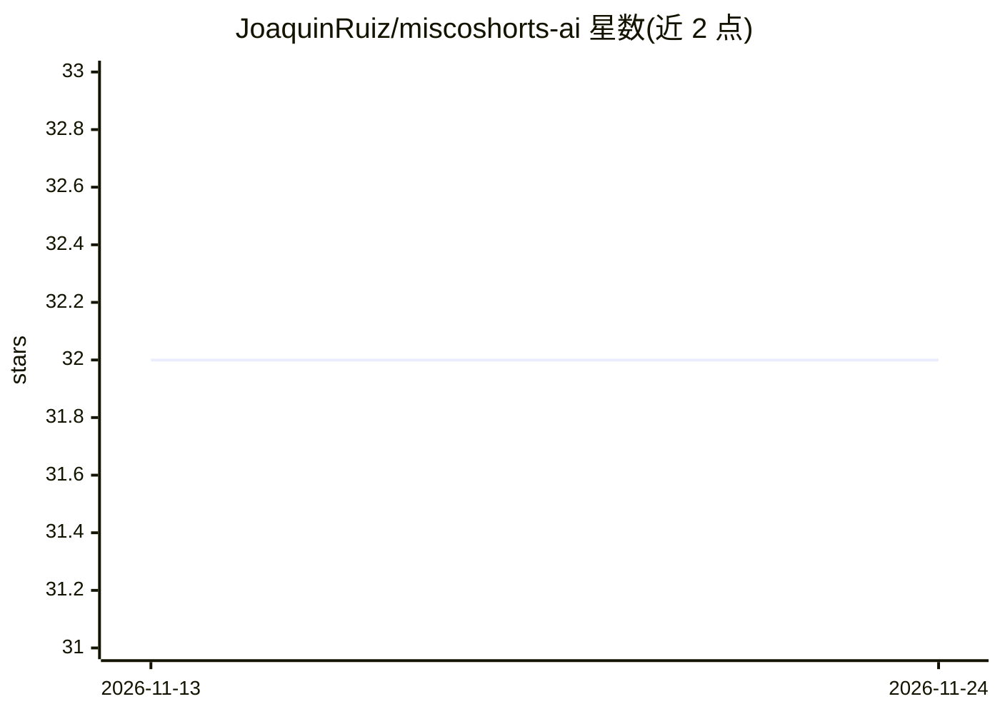

# JoaquinRuiz/miscoshorts-ai

⭐ 32 · Python · MIT · 推送 2026-11-13 · [GitHub](https://github.com/JoaquinRuiz/miscoshorts-ai) · [官网](https://youtu.be/zukJLVUwMxA) · 个人维护

**把长视频自动转为带字幕竖屏 Shorts 的 CLI 工具**

用 Python 编写的命令行工具：下载 YouTube 视频或读取本地文件，用 Whisper 转录，由 LLM（默认 Google Gemini，或任意 OpenAI 兼容服务如 Ollama/LM Studio/llama.cpp）挑选 30–60 秒高传播潜力片段，重构成 9:16 竖屏（可选跟随人脸的智能裁剪），逐词烧录字幕，并生成标题、描述与话题标签。用户确认建议后渲染，可完全本地运行。作者自称 OpusClip 的免费开源替代，教程为西班牙语。

## 筛选速览

| 维度 | 判定 | 备注 |
|---|---|---|
| AI 角色 | `ai-native` | 本体是模型或模型工具 |
| 许可风险 | `permissive` | MIT |
| 部署形态 | `library` | 以包/库形式分发 |
| 模型依赖 | local-ok | 支持本地模型 |
| 硬件要求 | — | 无带数字的原话,不猜 |
| 安装摩擦 | `medium` | 含编译或系统依赖之一 |
| 成熟度 | — | 结构信号不足 |

## 能力要点

- Whisper / faster-whisper / whisper.cpp server 三种转录引擎，转写结果缓存
- Gemini 或任意 OpenAI 兼容本地 LLM 做片段选择，输出经校验的 JSON
- 智能裁剪跟随说话人脸，中心裁剪兜底；逐词高亮字幕
- 每视频可生成多个 Shorts（-n 3），按传播分排序，可 100% 本地运行

## 适用场景

- 把长视频自动切成多条可发布的竖屏短视频
- 在本地无 API key 环境下完成转录与片段挑选
- 为 TikTok / Reels / Shorts 批量生成带标题与标签的成片

## 场景标签

`图像视频处理` · 领域:感知与多模态

## 证据(README 行号)

> L22: Miscoshorts downloads a video, transcribes it with Whisper, asks an LLM for the 30–60 second segments with the most
> L24: It works out of the box with **Google Gemini + local Whisper**, and can run **fully on your own machine** with any 

## 星数曲线

2026-11-13 32 → 2026-11-24 32（+0）

---
*卡片 v1 · prompt 1.4 · 生成 2026-11-18 · 置信度 high · 依据 README sha `ba620c135fc4` · [字段定义](../../DATASET.md)*
