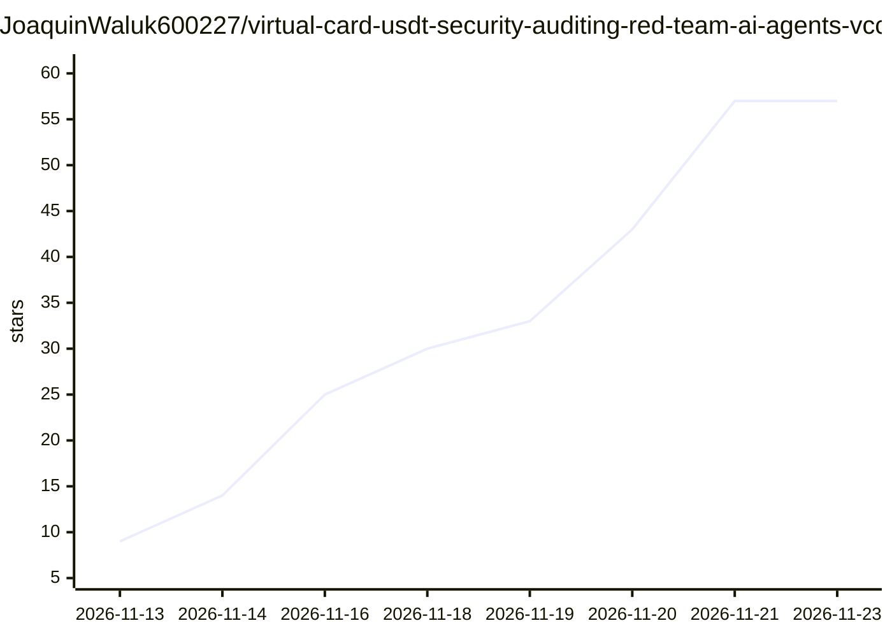

# JoaquinWaluk600227/virtual-card-usdt-security-auditing-red-team-ai-agents-vcc

⭐ 57 · 推送 2026-11-13 · [GitHub](https://github.com/JoaquinWaluk600227/virtual-card-usdt-security-auditing-red-team-ai-agents-vcc) · [官网](https://app.coregold.io/signup?invite_code=ADvlj9b) · 个人维护

**面向自主安全审计 agent 的虚拟卡付费隔离指南**

一份架构性 FinOps 与支付清算指南，描述安全团队如何为自主红队/漏洞审计 agent 配置临时虚拟卡（VCC）：通过 USDT 充值转换为美元余额、按审计周期签发带硬性消费上限的商业 BIN 虚拟卡、经 Apple Pay 令牌化或直接绑定 PAN/AVS 完成支付、审计结束后一键销毁卡回收余额。文档形态为指南与流程图，未提供可安装的代码或工具。

## 筛选速览

| 维度 | 判定 | 备注 |
|---|---|---|
| AI 角色 | `ai-knowledge` | 知识聚合/清单类 |
| 许可风险 | `none` | — |
| 部署形态 | `None` |  |
| 模型依赖 | — | README 未给出锁定关系 |
| 硬件要求 | — | 无带数字的原话,不猜 |
| 安装摩擦 | `low` | 无编译、无系统依赖或容器化 |
| 成熟度 | — | 结构信号不足 |

## 能力要点

- USDT 充值→临时虚拟卡→支付→销毁的四步部署蓝图
- 按审计周期设置硬性消费上限以隔离递归循环烧费风险
- Apple Pay DPAN 令牌化与原始卡号不出浏览器配置文件的路径
- 静态卡与临时 VCC 的控制维度对照表

## 适用场景

- 为在 CI 沙箱中运行的安全审计 agent 设置短期付费凭证
- 避免静态公司卡暴露在高权限测试运行器环境中
- 按审计冲刺拆分计费与消费额度

## 场景标签

`网络安全` · 领域:学习与行业

## 证据(README 行号)

> L2: An architectural FinOps and payment-clearing guide for autonomous AI security auditing &amp; red-teaming agents (Cla
> L7: Because security agents run inside high-risk test environments with elevated shell and network permissions, storing 

## 星数曲线

2026-11-13 9 → 2026-11-23 57（+48）

---
*卡片 v1 · prompt 1.4 · 生成 2026-11-18 · 置信度 low · 依据 README sha `dcb26d7b94ef` · [字段定义](../../DATASET.md)*
