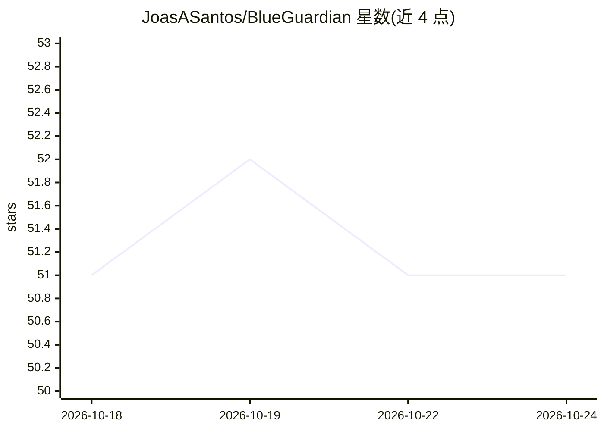

# JoasASantos/BlueGuardian

⭐ 51 · Python · 推送 2025-12-23 · [GitHub](https://github.com/JoasASantos/BlueGuardian) · 个人维护

**多模型驱动的蓝队安全分析框架：恶意软件/钓鱼/日志等分析**

面向蓝队安全运营的 Python 分析框架，接入 Claude、GPT-4、Gemini 与本地 Ollama 多种模型，提供恶意软件、文档、钓鱼邮件、内存取证（Volatility 3）、网络情报、SIEM 日志与事件响应等专用 Agent。核心机制为多模型共识防幻觉：并行查询多模型、提取声明、相似性分析、置信度评分并用安全工具输出交叉验证。集成 VirusTotal、MITRE ATT&CK、AlienVault OTX 等情报源，Docker 沙箱（可选）隔离执行可疑文件。提供交互式/批处理 CLI、FastAPI REST API 与 React Web UI，报告可导出 HTML/PDF/JSON。需 Python 3.11+ 与至少一个 AI 提供商的 API key。

## 筛选速览

| 维度 | 判定 | 备注 |
|---|---|---|
| AI 角色 | `ai-native` | 本体是模型或模型工具 |
| 许可风险 | `permissive` | — |
| 部署形态 | `desktop` | 安装包/桌面程序 |
| 模型依赖 | local-ok | 支持本地模型 |
| 硬件要求 | — | 无带数字的原话,不猜 |
| 安装摩擦 | `low` | 无编译、无系统依赖或容器化 |
| 成熟度 | — | 结构信号不足 |

## 能力要点

- 7 类专用分析 Agent（恶意软件/文档/钓鱼/内存/网络/SIEM/IR）
- 多模型共识防幻觉机制（并行查询、声明抽取、工具输出交叉验证）
- MCP 协议接入安全工具，Docker 沙箱隔离执行可疑文件
- CLI / REST API / React Web UI 三种界面，报告导出 HTML/PDF/JSON

## 适用场景

- 分析可疑 PE/ELF/文档/邮件样本并提取 IOC
- 对 SIEM 日志做暴力破解、提权、横向移动检测
- 通过多模型共识降低 AI 安全分析中的幻觉输出

## 场景标签

`网络安全` `多智能体` · 领域:Agent 开发

## 证据(README 行号)

> L9: BlueGuardian AI is a comprehensive security analysis framework designed specifically for **Blue Team** operations, c
> L15: - **Multi-Model AI Integration**: Leverage Claude, GPT-4, Gemini, and local Ollama models
> L16: - **Hallucination Prevention**: Multi-model consensus system validates AI outputs

## 星数曲线

2026-10-18 51 → 2026-10-24 51（+0）

---
*卡片 v1 · prompt 1.4 · 生成 2026-10-24 · 置信度 mid · 依据 README sha `cdd9612700f0` · [字段定义](../../DATASET.md)*
