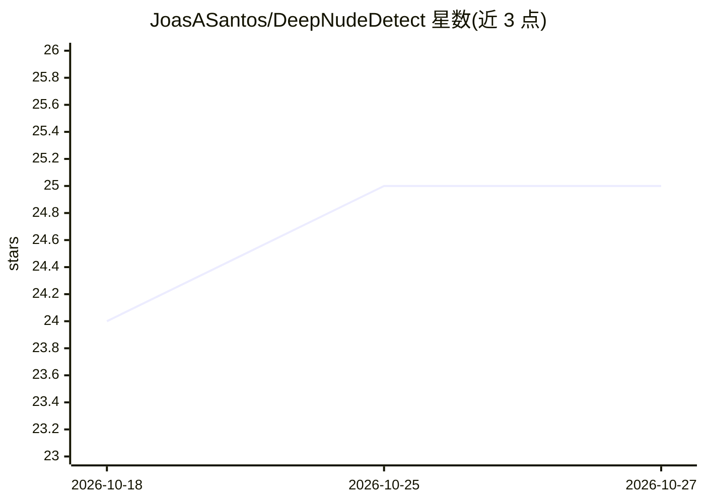

# JoasASantos/DeepNudeDetect

⭐ 25 · Python · NOASSERTION · 推送 2026-01-03 · [GitHub](https://github.com/JoasASantos/DeepNudeDetect) · 个人维护

**检测深度伪造/Deepnude/NSFW 图片并提供图像保护的开源系统**

面向内容审核与个人防护场景的图像检测系统：组合 NudeNet、CLIP、自定义 CNN 等多个模型检测 AI 生成裸体图像、换脸伪造与 NSFW/NSFL 内容；同时提供对抗扰动与 Fawkes 式面部遮挡等图像保护功能。架构包含 FastAPI 后端、React 网页界面与 Chrome 扩展，支持文件上传、URL、文件夹及可移动磁盘扫描等输入方式；默认本地处理，可选接入 OpenAI Vision、Gemini、AIorNot API。需分别安装前后端依赖并下载模型，MIT 许可但限定合法用途。

## 筛选速览

| 维度 | 判定 | 备注 |
|---|---|---|
| AI 角色 | `ai-native` | 本体是模型或模型工具 |
| 许可风险 | `none` | NOASSERTION |
| 部署形态 | `library` | 以包/库形式分发 |
| 模型依赖 | — | README 未给出锁定关系 |
| 硬件要求 | — | 无带数字的原话,不猜 |
| 安装摩擦 | `low` | 无编译、无系统依赖或容器化 |
| 成熟度 | — | 结构信号不足 |

## 能力要点

- 多模型组合检测 deepnude、deepfake 与 NSFW/NSFL 内容
- 对抗扰动与 Fawkes 式面部遮挡保护图像
- FastAPI 后端 + React 前端 + Chrome 扩展三组件
- 默认全部本地处理，API 密钥为可选增强

## 适用场景

- 扫描本地文件夹或移动硬盘批量检测伪造/NSFW 图片
- 上传或 URL 方式分析单张可疑图片
- 为个人照片添加对抗扰动防止被用于深度伪造生成

## 场景标签

`目标检测` `图像视频处理` `网络安全` · 领域:学习与行业

## 证据(README 行号)

> L8: - **Deepnude Detection**: Identifies AI-generated nude imagery
> L11: - **Multi-Model Analysis**: Combines multiple AI models for robust detection
> L118: 1. **NudeNet** - NSFW detection

## 星数曲线

2026-10-18 24 → 2026-10-27 25（+1）

---
*卡片 v1 · prompt 1.4 · 生成 2026-10-27 · 置信度 high · 依据 README sha `0b679697cf6e` · [字段定义](../../DATASET.md)*
