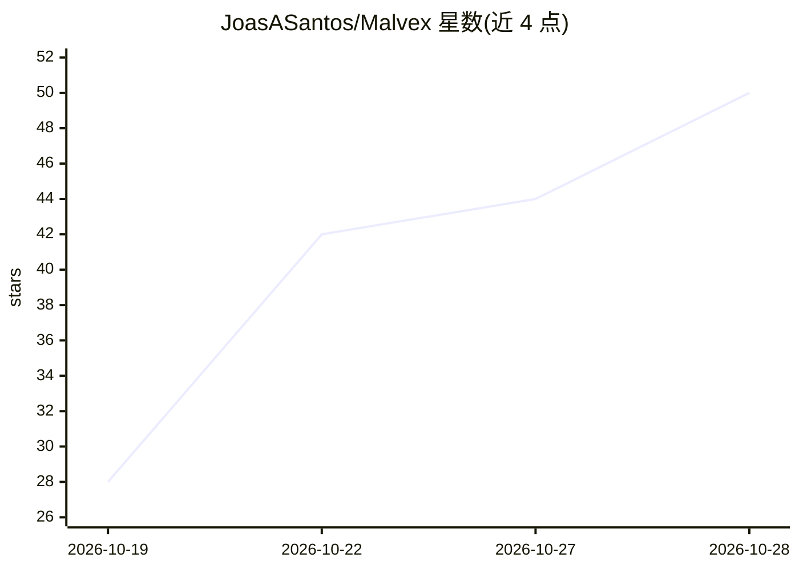

# JoasASantos/Malvex

⭐ 52 · Rust · 推送 2026-10-16 · [GitHub](https://github.com/JoasASantos/Malvex) · 个人维护

**本地优先的恶意软件分析编排框架：用 AI agent 驱动逆向工具链**

Malvex 是一个本地运行的编排框架，通过 MCP（Model Context Protocol）把 AI agent 接到 126 个逆向与恶意软件分析工具（IDA、Ghidra、radare2、Frida、volatility3、YARA 等）。输入二进制、内存转储、文档或抓包后，它分诊样本并调度 15 个专用 agent 按六阶段流水线（分诊/静态/动态/网络/情报/验证）并行工作，输出 IOC、MITRE ATT&CK 映射、检测规则与攻击链图。明确定义 LLM 输出不作为证据，需静态或运行时证据佐证。支持 Claude Code、Codex CLI、Ollama 等多种运行时，并提供 MCP server 模式供任意 agent 接入。

## 筛选速览

| 维度 | 判定 | 备注 |
|---|---|---|
| AI 角色 | `ai-ecosystem` | LLM/agent 周边工具 |
| 许可风险 | `none` | — |
| 部署形态 | `desktop` | 安装包/桌面程序 |
| 模型依赖 | local-ok | 支持本地模型 |
| 硬件要求 | — | 无带数字的原话,不猜 |
| 安装摩擦 | `medium` | 含编译或系统依赖之一 |
| 成熟度 | — | 结构信号不足 |

## 能力要点

- 通过 MCP 连接 AI agent 与 126 个逆向/恶意软件分析工具
- 六阶段流水线：分诊→静态→动态→网络→情报→验证
- 证据门机制：LLM 输出仅视为分析线索，无独立证据复现不得标记为 confirmed
- malvex serve 以 JSON-RPC 2.0 暴露 MCP server（30 个分析工具）

## 适用场景

- 对可疑二进制、内存转储或文档做本地自动化逆向分析
- 生成 IOC、MITRE ATT&CK 映射与 YARA/Sigma 检测规则
- 让 Claude Code、Cursor 等 AI agent 通过 MCP 直接调用逆向分析工具

## 场景标签

`网络安全` `多智能体` · 领域:Agent 开发

## 证据(README 行号)

> L5: Malvex is a local-first orchestration harness that connects AI agents to 126 reverse-engineering and malware-analysi
> L53: |`malvex serve --mcp`|MCP server mode (JSON-RPC 2.0 over stdio, 8 tools)|
> L239: `malvex serve` exposes 30 analysis tools over MCP (JSON-RPC 2.0, stdio transport). Any AI agent — Claude Code, Cur

## 星数曲线

2026-10-19 28 → 2026-10-28 50（+22）

---
*卡片 v1 · prompt 1.4 · 生成 2026-10-25 · 置信度 mid · 依据 README sha `e41712f53583` · [字段定义](../../DATASET.md)*
