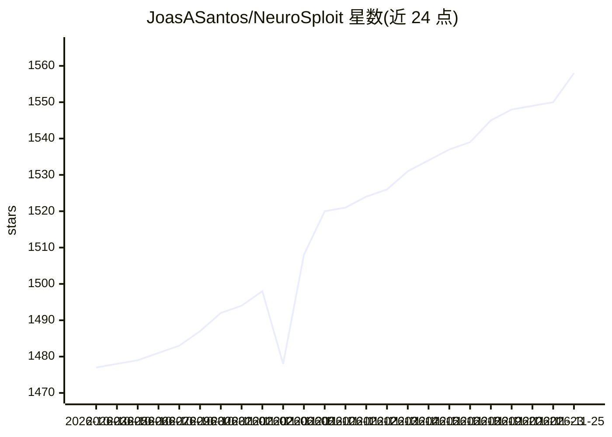

# JoasASantos/NeuroSploit

⭐ 1,558 · Rust · MIT · 推送 2026-11-23 · [GitHub](https://github.com/JoasASantos/NeuroSploit) · [官网](https://neurosploitai.github.io/) · 个人维护

**授权渗透测试的自主化 Rust 编排框架，多模型验证产出报告**

面向授权渗透测试场景的 CLI 工具：目标是让编排器自主完成侦察、利用、验证并生成报告，LLM 仅作为执行端，Rust 引擎负责流程纪律——并行调度专家 agent、对每条声明进行线上重放确认、由第二个模型交叉投票后再写入报告。提供黑盒/白盒/灰盒/主机/移动/容器/AI-LLM 共 8 种模式，通过 MCP Profile 在运行时切换工具面（Playwright、Burp、Nmap、Kali 等），内置 225 个工具并支持 C2、多跳代理。输出 HTML/PDF/Markdown 报告、SARIF、攻击图谱与 PoC。仅限授权测试使用。

## 筛选速览

| 维度 | 判定 | 备注 |
|---|---|---|
| AI 角色 | `ai-native` | 本体是模型或模型工具 |
| 许可风险 | `permissive` | MIT |
| 部署形态 | `None` |  |
| 模型依赖 | local-ok | 支持本地模型 |
| 硬件要求 | — | 无带数字的原话,不猜 |
| 安装摩擦 | `low` | 无编译、无系统依赖或容器化 |
| 成熟度 | — | 结构信号不足 |

## 能力要点

- Rust 编排器自主运行评估流程：侦察→并行利用→线上重放验证→跨模型投票→报告
- 8 种测试模式（黑盒/白盒/灰盒/主机/移动/容器/AI-LLM/TUI），经 MCP Profile 切换工具面
- 多模型投票与 19 个 LLM provider 接入（API key 或本地订阅）
- 输出 SARIF、攻击知识图谱、Cypher/Mermaid 导出及脱敏后的 PoC 与证据

## 适用场景

- 对授权目标自主执行 Web/API 渗透评估并拿到带证据的报告
- 对代码仓库做白盒 SAST 审查并给出 file:line 证据
- 对 APK/IPA 与容器镜像做逆向与 SBOM 扫描
- 对 LLM 应用做越狱与提示注入类测试（OWASP LLM Top 10）

## 场景标签

`网络安全` `代码审查` · 领域:编码与开发

## 证据(README 行号)

> L22: Point it at a target. It runs the security assessment autonomously and hands you a report — recon, exploitation, ch
> L24: **The harness is the pentester, not the model.** A Rust engine runs the methodology: picks specialist agents for wh
> L112: 19 LLM providers supported — API key or local subscription:

## 星数曲线

2026-10-23 1,477 → 2026-11-25 1,558（+81）

---
*卡片 v1 · prompt 1.4 · 生成 2026-11-24 · 置信度 high · 依据 README sha `9e097d8c9d3b` · [字段定义](../../DATASET.md)*
