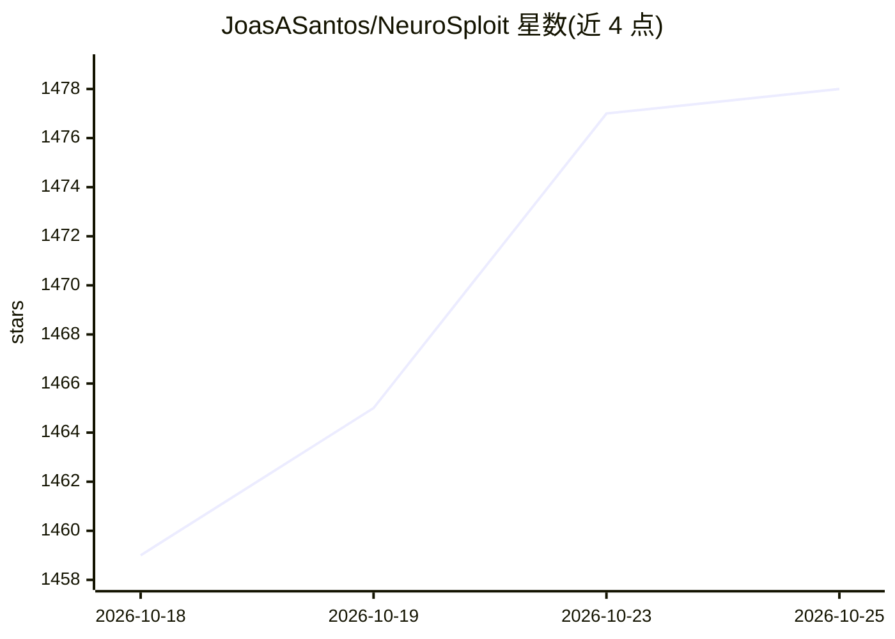

# JoasASantos/NeuroSploit

⭐ 1,479 · Rust · MIT · 推送 2026-10-19 · [GitHub](https://github.com/JoasASantos/NeuroSploit) · [官网](https://neurosploitai.github.io/) · 组织维护

**面向授权测试的自主多模型渗透测试工具，Rust 驱动**

用 Rust 编写的 CLI 渗透测试工具：给定 URL、源码仓库、应用或主机 IP，由 Rust 引擎（tokio）驱动 LLM 代理池执行侦察、利用、证据回放验证、跨模型裁决与链式影响分析，最终产出报告。模型通过 API key 或本地订阅（Claude Code/Codex/Gemini/Grok）接入，支持 19 家供应商含 ollama/llamacpp 本地运行。含 486 个 markdown 代理、8 种测试模式（黑盒/白盒/AI 测试/容器等）、Web 控制台与 TUI，输出 SARIF/PDF/攻击图。MIT 许可，仅限授权测试。

## 筛选速览

| 维度 | 判定 | 备注 |
|---|---|---|
| AI 角色 | `ai-native` | 本体是模型或模型工具 |
| 许可风险 | `permissive` | MIT |
| 部署形态 | `None` |  |
| 模型依赖 | local-ok | 支持本地模型 |
| 硬件要求 | `cpu-ok` | |
| 安装摩擦 | `medium` | 含编译或系统依赖之一 |
| 成熟度 | — | 结构信号不足 |

## 能力要点

- Rust 引擎驱动 LLM 代理池自主完成侦察→利用→验证→报告全流程
- 每条发现需线级证据回放复现并由第二模型裁决
- 486 个可读可编辑的 markdown 代理覆盖 web/SAST/AI/云/AD
- 19 家模型供应商，支持 ollama/llamacpp 本地 CPU 运行

## 适用场景

- 对授权目标执行自动化渗透测试并获得带证据的报告
- 在 CI 中以 PR 审查门禁拦截高危漏洞
- 测试 LLM 应用的越狱与提示注入（OWASP LLM Top 10）

## 场景标签

`网络安全` `多智能体` · 领域:Agent 开发

## 证据(README 行号)

> L15: **NeuroSploit is an autonomous penetration-testing tool.** You point it at a
> L33: harness (`tokio`) drives a **pool of LLMs** — via **API key** or local

## 星数曲线

2026-10-18 1,459 → 2026-10-25 1,478（+19）

---
*卡片 v1 · prompt 1.4 · 生成 2026-10-21 · 置信度 high · 依据 README sha `2703fa0ca1f1` · [字段定义](../../DATASET.md)*
