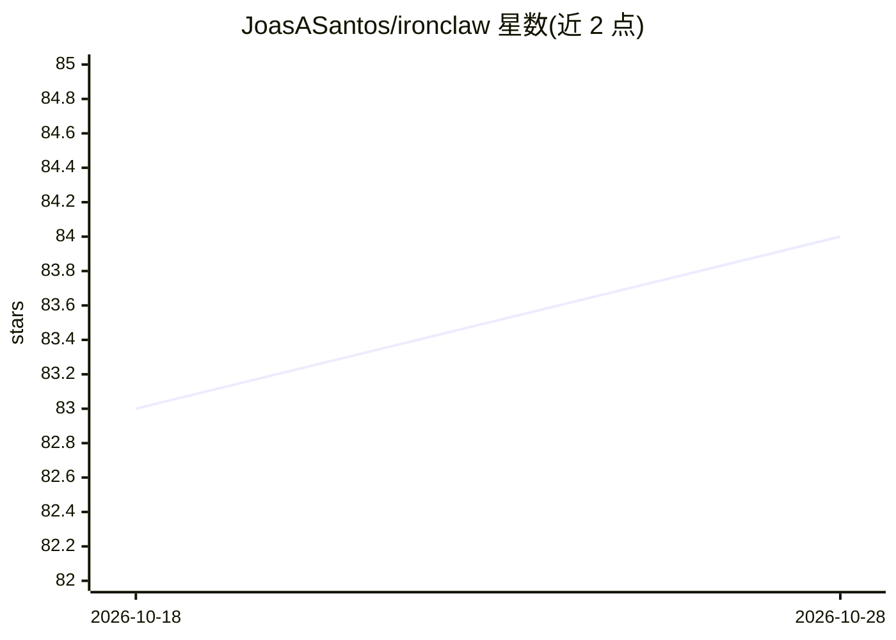

# JoasASantos/ironclaw

⭐ 84 · Rust · 推送 2026-02-18 · [GitHub](https://github.com/JoasASantos/ironclaw) · 个人维护

**安全优先的 Rust AI Agent 框架，支持 25+ 提供商**

用 Rust 编写的 AI agent 框架，定位安全优先：所有工具执行经过验证、沙箱（Docker/Bubblewrap/Native）与审计，共 13 层安全机制，包括命令黑名单校验、RBAC、技能 Ed25519 签名验证、DLP、SSRF 防护与反窃密检测。支持 25+ LLM 提供商（含 Ollama 等本地模型）、20 种通信通道（Slack/Discord/Telegram 等）、DAG 工作流引擎与多智能体协作。面向需要安全管控地构建与运行 AI agent 的开发者，从源码克隆并用 Rust 工具链编译运行。

## 筛选速览

| 维度 | 判定 | 备注 |
|---|---|---|
| AI 角色 | `ai-ecosystem` | LLM/agent 周边工具 |
| 许可风险 | `none` | — |
| 部署形态 | `library` | 以包/库形式分发 |
| 模型依赖 | local-ok | 支持本地模型 |
| 硬件要求 | — | 无带数字的原话,不猜 |
| 安装摩擦 | `low` | 无编译、无系统依赖或容器化 |
| 成熟度 | — | 结构信号不足 |

## 能力要点

- 25+ LLM 提供商接入，含 Ollama/LM Studio 等本地模型预设
- 13 层安全管线：命令校验、RBAC、沙箱、技能签名、DLP、SSRF 防护等
- 20 种通信通道（Slack、Discord、Telegram、WhatsApp 等）带安全管线
- DAG 工作流引擎与多智能体编排（6 角色、5 协作模式）

## 适用场景

- 构建对工具执行有严格安全审计要求的 AI agent
- 通过 Slack/Discord/Telegram 等多通道接入个人助手
- 用本地模型（Ollama/LM Studio）运行无需 API key 的 agent

## 场景标签

`Agent 框架` `多智能体` · 领域:Agent 开发

## 证据(README 行号)

> L14: IronClaw is a production-grade AI agent framework written in **Rust**, engineered from the ground up with **securit
> L143: IronClaw supports **25+ LLM providers** out of the box:

## 星数曲线

2026-10-18 83 → 2026-10-28 84（+1）

---
*卡片 v1 · prompt 1.4 · 生成 2026-10-24 · 置信度 mid · 依据 README sha `2b22b7bf0216` · [字段定义](../../DATASET.md)*
