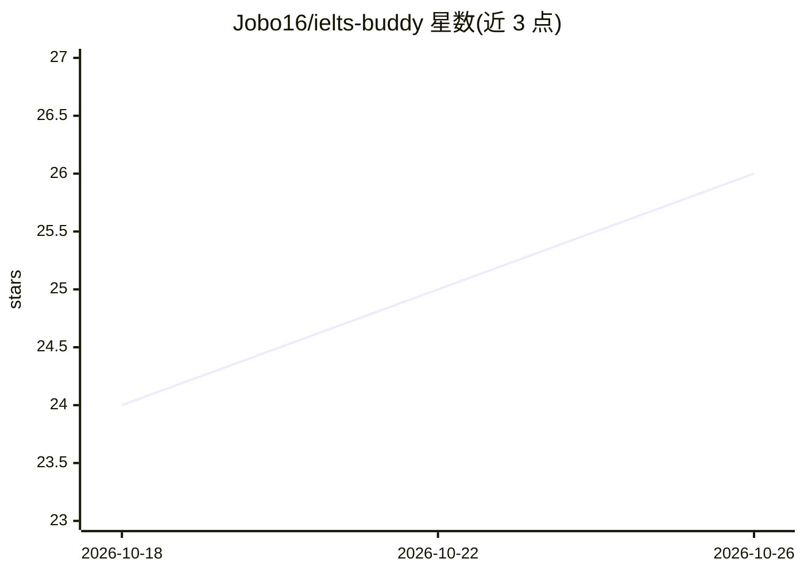

# Jobo16/ielts-buddy

⭐ 26 · Python · MIT · 推送 2026-09-10 · [GitHub](https://github.com/Jobo16/ielts-buddy) · [官网](https://ieltsbuddy.igopx.cn/skills) · 组织维护 · 中文 README

**面向本地 Agent 的雅思学习 Agent Skills 集合（脚本/技能/工作流）**

IELTS Buddy 面向 Codex、Claude Code、Cursor、WorkBuddy 等本地 Agent 分发的 Skills 仓库，分三层维护：scripts/ 通用处理脚本、skills/ 接口与权限说明、workflows/ 可选推荐用法。覆盖 10 个可安装 Skill，包括学习计划、写作批改、口语陪练、阅读听力复盘、词汇与模考复盘等；通过 npx skills 安装，需 Node.js 18+。部分 Skill 需绑定 IELTS Buddy 账号读取个人学习数据；更新支持 GitHub 或阿里云 OSS 固定发行包两条通道。仓库声明不替代教师判断与官方评分，不承诺分数结果。

## 筛选速览

| 维度 | 判定 | 备注 |
|---|---|---|
| AI 角色 | `ai-knowledge` | 知识聚合/清单类 |
| 许可风险 | `permissive` | MIT |
| 部署形态 | `library` | 以包/库形式分发 |
| 模型依赖 | — | README 未给出锁定关系 |
| 硬件要求 | — | 无带数字的原话,不猜 |
| 安装摩擦 | `low` | 无编译、无系统依赖或容器化 |
| 成熟度 | — | 结构信号不足 |

## 能力要点

- 10 个可安装 Skill：学习计划、写作批改、口语陪练、阅读/听力/模考复盘、词汇管理等
- scripts/skills/workflows 三层分离，workflow 不强制采用
- 个人学习数据经 API 绑定后以只读快照方式导出，缓存按账号隔离
- GitHub 与 OSS 双更新通道，OSS 发行包固定 commit、版本与 SHA-256

## 适用场景

- 让本地 Agent 帮我制定并维护雅思学习计划
- 把作文交给 Agent 做教师式批改并管理修订版本
- 复盘阅读、听力练习与模考的作答数据
- 维护、导入导出和记录雅思词汇

## 场景标签

`Agent 框架` · 领域:Agent 开发

## 证据(README 行号)

> L3: IELTS Buddy 本地 Agent 仓库，面向 Codex、Claude Code、Cursor、WorkBuddy 等本地 Agent。仓库把可执行脚本、服务接口说明和可选推荐用法分开维护。
> L12: |Skills|`skills/`|说明脚本如何调用、可传输/获得的数据及权限边界。|
> L13: |Workflows|`workflows/`|可选推荐用法；不改变接口，也不强制本地 Agent 采用。|

## 星数曲线

2026-10-18 24 → 2026-10-26 26（+2）

---
*卡片 v1 · prompt 1.4 · 生成 2026-10-26 · 置信度 mid · 依据 README sha `da7aec666ae0` · [字段定义](../../DATASET.md)*
