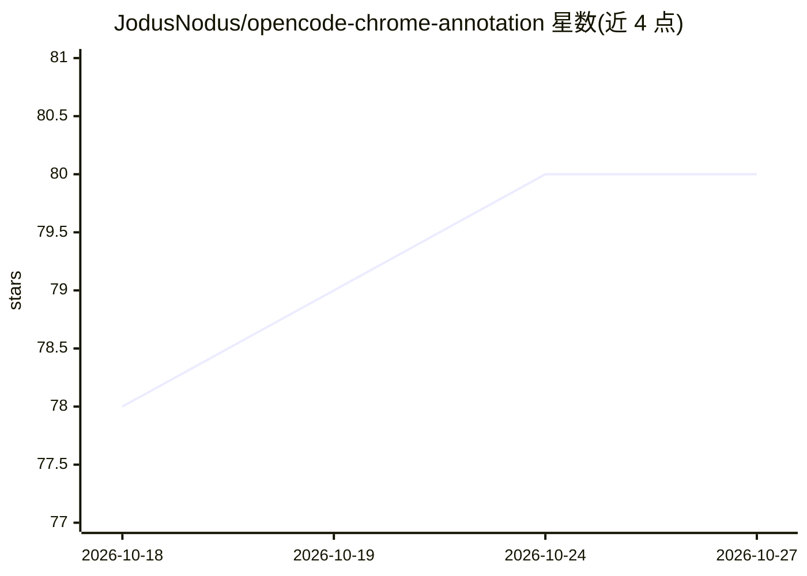

# JodusNodus/opencode-chrome-annotation

⭐ 80 · TypeScript · GPL-3.0 · 推送 2026-04-30 · [GitHub](https://github.com/JodusNodus/opencode-chrome-annotation) · 个人维护

**Chrome 标注插件：把截图、元素信息与指令发给 OpenCode**

由 OpenCode 插件与 Chrome 扩展两部分组成：用户在网页上选取元素、写指令，扩展将截图（本地保存）、页面 URL、标题及元素的 selector/tag/text/role/aria/bounds 等元数据发送到当前 OpenCode 会话。插件在本地 127.0.0.1 的 39240-39260 端口运行 HTTP 服务，扩展经 localhost 发现实例；要求 OpenCode 与浏览器处于同一 localhost 网络。面向使用 OpenCode 进行编码的用户，插件经配置安装，扩展从 Chrome Web Store 安装。

## 筛选速览

| 维度 | 判定 | 备注 |
|---|---|---|
| AI 角色 | `ai-ecosystem` | LLM/agent 周边工具 |
| 许可风险 | `viral` | GPL-3.0 |
| 部署形态 | `None` |  |
| 模型依赖 | — | README 未给出锁定关系 |
| 硬件要求 | — | 无带数字的原话,不猜 |
| 安装摩擦 | `low` | 无编译、无系统依赖或容器化 |
| 成熟度 | — | 结构信号不足 |

## 能力要点

- 页面元素选取并附带 selector/role/aria/bounds 元数据
- 截图本地保存并在 OpenCode prompt 中引用
- 插件经 127.0.0.1:39240-39260 与扩展通信

## 适用场景

- 在网页调试时直接把元素上下文交给 OpenCode 处理
- 结合截图与元素信息向编码 agent 下达指令
- 在活跃 OpenCode 会话中连接浏览器标签页

## 场景标签

`编码 Agent` · 领域:编码与开发

## 证据(README 行号)

> L6: Annotate any page in Chrome and send the screenshot, selected element metadata, and your instruction directly into O
> L27: 1. Start OpenCode in your project.

## 星数曲线

2026-10-18 78 → 2026-10-27 80（+2）

---
*卡片 v1 · prompt 1.4 · 生成 2026-10-24 · 置信度 high · 依据 README sha `0d64f695daec` · [字段定义](../../DATASET.md)*
