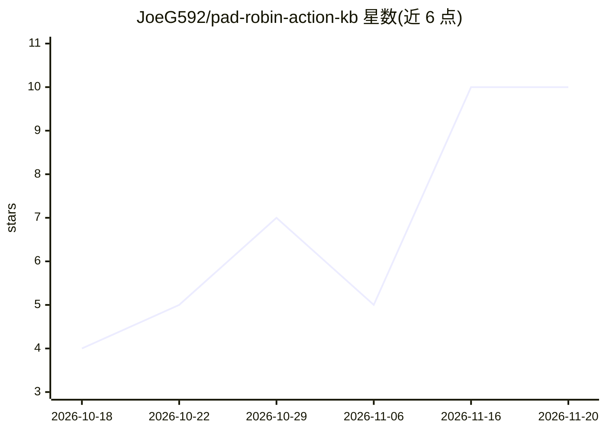

# JoeG592/pad-robin-action-kb

⭐ 10 · JavaScript · NOASSERTION · 推送 2026-11-07 · [GitHub](https://github.com/JoeG592/pad-robin-action-kb) · 个人维护

**给 AI 助手用的 1,135 条 PAD Robin 动作参考知识库**

Power Automate Desktop（PAD）背后 Robin 脚本语言的粘贴验证参考库：收录 1,135 个动作（46 个模块），每条含模板、零错误粘贴进 Designer 的黄金示例、带类型的输入输出参数、同动作的其他选择器变体及 ON ERROR 处理信息；另有 44 种参数类型的语法参考、Classic 与 Power Fx 两个版本、456 条探针粘贴语料及部署/解决方案迁移指南。设计用法是通过系统提示词让模型做查表与替换而非代码生成。全部黄金示例已在 PAD 2.74 上重新粘贴验证，CC BY 4.0 许可。

## 筛选速览

| 维度 | 判定 | 备注 |
|---|---|---|
| AI 角色 | `ai-knowledge` | 知识聚合/清单类 |
| 许可风险 | `none` | NOASSERTION |
| 部署形态 | `None` |  |
| 模型依赖 | — | README 未给出锁定关系 |
| 硬件要求 | — | 无带数字的原话,不猜 |
| 安装摩擦 | `low` | 无编译、无系统依赖或容器化 |
| 成熟度 | — | 结构信号不足 |

## 能力要点

- 1,135 个 Robin 动作、46 个模块，黄金示例在 PAD 2.74 零错误粘贴验证
- Classic 与 Power Fx 双版本知识库及对应系统提示词
- 456 条探针粘贴语料记录 PAD 的实际接受/拒绝结果
- 部署 KB 与 Solutions KB 覆盖 Flow API、Dataverse 与跨租户方案迁移

## 适用场景

- 让 AI 助手生成能直接粘贴进 PAD Designer 的桌面流程脚本
- 查阅某动作的参数类型、枚举值与选择器变体
- 为动作配置正确的 ON ERROR 错误处理
- 用代码方式部署流程或在环境/租户间迁移 Power Platform 解决方案

## 场景标签

`知识库管理` · 领域:知识与检索

## 证据(README 行号)

> L3: A paste-validated reference for the Robin scripting language behind Power Automate Desktop (PAD), built so AI assist
> L17: |`PAD_Robin_ActionKB.json`|1,135 Robin actions across 46 modules. Every record has a template, a golden example tha
> L19: |`PROMPT.md`|A system prompt that turns a model into a template filler over these two files. This is how the data i

## 星数曲线

2026-10-18 4 → 2026-11-20 10（+6）

---
*卡片 v1 · prompt 1.4 · 生成 2026-11-20 · 置信度 high · 依据 README sha `4dd7c9049cca` · [字段定义](../../DATASET.md)*
