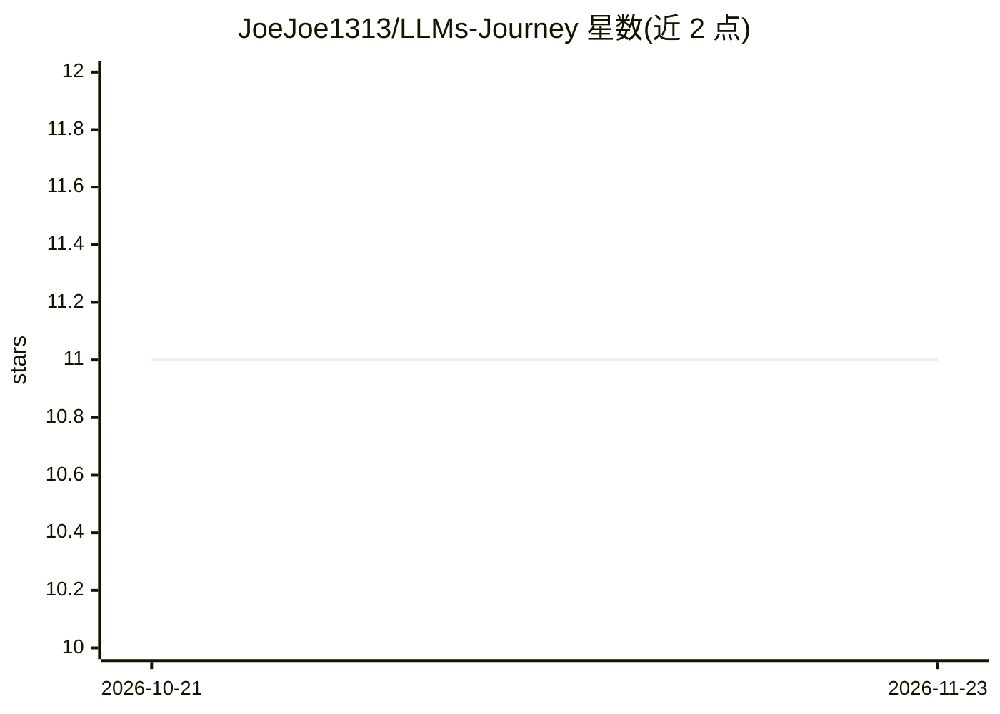

# JoeJoe1313/LLMs-Journey

⭐ 11 · Jupyter Notebook · 推送 2026-06-28 · [GitHub](https://github.com/JoeJoe1313/LLMs-Journey) · [官网](https://joejoe1313.github.io/LLMs-Journey/) · 个人维护

**LLM 学习资源与实验的博客文章/论文聚合清单**

该仓库汇集 LLM 领域的学习资源与作者撰写的教程博客文章，主题覆盖微调（LoRA/QLoRA）、Agent 系统与工作流、RAG、视觉语言模型及端侧 AI 等；正文由分类的博客文章链接、阅读书单、论文列表（含推理、测试时计算、OCR、多模态等方向）与外部资源链接（MLX 示例、向量数据库、框架）组成，不含安装或运行说明。

## 筛选速览

| 维度 | 判定 | 备注 |
|---|---|---|
| AI 角色 | `ai-knowledge` | 知识聚合/清单类 |
| 许可风险 | `none` | — |
| 部署形态 | `None` |  |
| 模型依赖 | — | README 未给出锁定关系 |
| 硬件要求 | — | 无带数字的原话,不猜 |
| 安装摩擦 | `low` | 无编译、无系统依赖或容器化 |
| 成熟度 | — | 结构信号不足 |

## 能力要点

- 作者的多篇 MLX-LM/MLX-VLM 实操教程博客（微调、函数调用、工具使用）
- 按 Agents/微调/RAG/评估/数据集/模型/视觉等主题组织的论文清单
- Apple/MLX、LangChain、向量数据库、HuggingFace 等外部资源链接

## 适用场景

- 系统查找 LLM 微调、Agent、RAG 方向的入门与进阶阅读材料
- 了解 VLM 与 OCR 相关的最新论文列表
- 寻找 MLX 在 Apple 芯片上的示例与社区资源

## 场景标签

`教程课程` `精选清单` · 领域:学习与行业

## 证据(README 行号)

> L3: The **LLMs-Journey** repository covers topics including:
> L41: ## What to read?
> L171: ## Resources

## 星数曲线

2026-10-21 11 → 2026-11-23 11（+0）

---
*卡片 v1 · prompt 1.4 · 生成 2026-11-19 · 置信度 high · 依据 README sha `14518d1a7226` · [字段定义](../../DATASET.md)*
