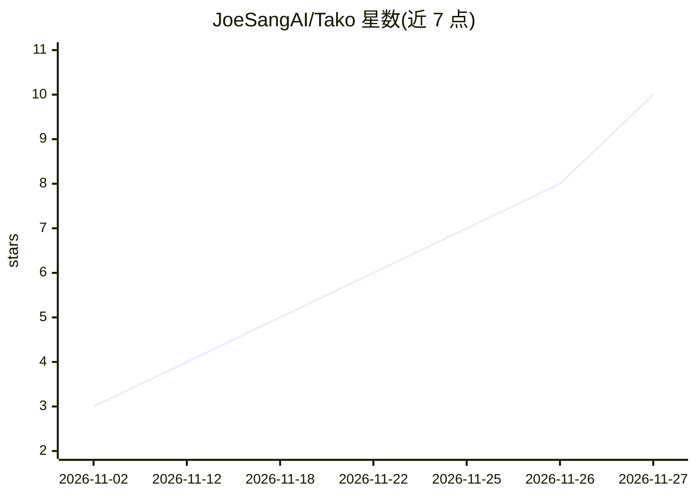

# JoeSangAI/Tako

⭐ 10 · Python · MIT · 推送 2026-11-23 · [GitHub](https://github.com/JoeSangAI/Tako) · 个人维护 · 中文 README

**Mac 桌面智能体：黏在任意窗口上替你看和操作**

macOS 原生应用（Swift + Python），把图标拖到任意窗口后可读取该窗口内容并代为操作：填表、圈重点、起草邮件和聊天回复。发送类动作被系统级硬规则拦截，最后一步留给用户；删除、支付等操作先弹卡片审批。通过接入已有模型服务或粘贴 API key 工作，支持 Codex、Claude Code 等外部 Agent 通过命令行派活。内测阶段，仅支持 Apple 芯片，未做 Apple 公证，需脚本安装并授予辅助功能与录屏权限。

## 筛选速览

| 维度 | 判定 | 备注 |
|---|---|---|
| AI 角色 | `ai-native` | 本体是模型或模型工具 |
| 许可风险 | `permissive` | MIT |
| 部署形态 | `None` |  |
| 模型依赖 | — | README 未给出锁定关系 |
| 硬件要求 | — | 无带数字的原话,不猜 |
| 安装摩擦 | `low` | 无编译、无系统依赖或容器化 |
| 成熟度 | `idea` | |

## 能力要点

- 任意窗口可见并可后台操作，⌃点按指定元素
- 发送、支付、删除等动作的系统级拦截与审批卡片
- 支持 ChatGPT 登录、办公智能体账号或 DeepSeek/通义/Kimi/智谱 API key 接入
- 本地优先：对话记录与产出文件存于本地文件夹，改文件前自动备份

## 适用场景

- 听课/长网页时让它记笔记、画脑图、圈出关键句
- 让 AI 直接填报销表单和邮件草稿，自己最后点发送
- 把要动窗口的任务从 Claude Code/Codex 脚本派给 Tako

## 场景标签

`GUI 自动化` `AI 助手` · 领域:效率与自动化

## 证据(README 行号)

> L7:  Mac 上的黏人智能体。把小章鱼拖到任何窗口上，说一句话：它看得见这个窗口，也会替你操作。 不用切到聊天框，不用复述屏幕，说完就能去忙别的。发送键它不按，留给你。
> L100: 这不是写给模型的约定，是系统里的硬规则，模型怎么想都按不下去：点“发送”按钮、聊天软件里按回车、⌘回车、邮件脚本的 send，都会被拒绝，你批准也不行。代码就在 Operate.swift 和 guards.py 里，对应的测试
> L185: Tako 是 Swift + Python 写的原生 app，模型通过本机的 `codex app-server` 连接，用办公智能体登录时换成它们自带的命令行智能体（ACP 协议）。架构说明是一张代码地图。

## 星数曲线

2026-11-02 3 → 2026-11-27 10（+7）

---
*卡片 v1 · prompt 1.4 · 生成 2026-11-21 · 置信度 high · 依据 README sha `db9f8e4ff4b1` · [字段定义](../../DATASET.md)*
