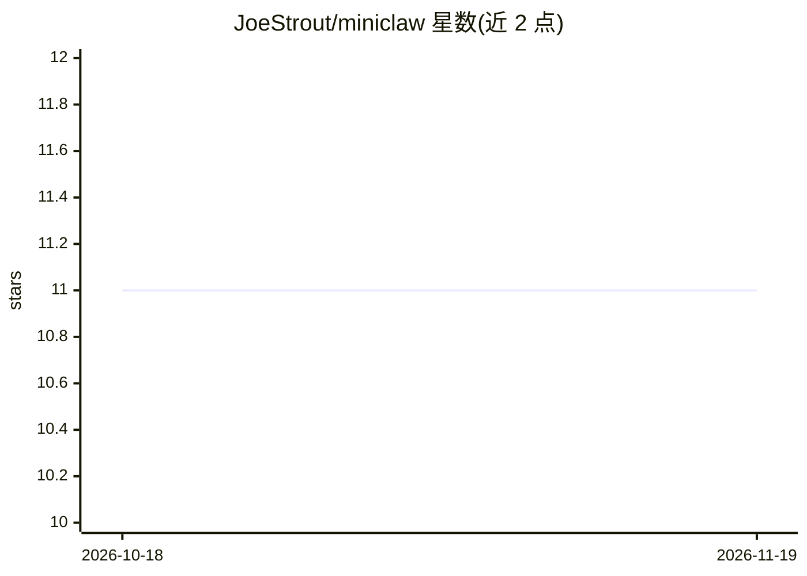

# JoeStrout/miniclaw

⭐ 11 · MAXScript · 推送 2026-04-16 · [GitHub](https://github.com/JoeStrout/miniclaw) · [官网](https://miniscript.org/MiniMicro/) · 个人维护

**运行在 Mini Micro 沙箱中的 MiniScript LLM agent**

MiniClaw 用 MiniScript 编写、运行于 Mini Micro 虚拟机内，是一个可通过多步工具调用执行扩展任务的软件 bot。README 给出两个特点：代码规模小、语言简单易读（附一页速查表）；依托 Mini Micro 的沙箱隔离，agent 出错或失控时影响限于其自身文件。项目另有 dev.to 文章说明实现原理，并与 OpenClaw、Hermes 属同类定位。

## 筛选速览

| 维度 | 判定 | 备注 |
|---|---|---|
| AI 角色 | `ai-native` | 本体是模型或模型工具 |
| 许可风险 | `none` | — |
| 部署形态 | `None` |  |
| 模型依赖 | — | README 未给出锁定关系 |
| 硬件要求 | — | 无带数字的原话,不猜 |
| 安装摩擦 | `low` | 无编译、无系统依赖或容器化 |
| 成熟度 | — | 结构信号不足 |

## 能力要点

- 以 MiniScript 编写、在 Mini Micro 内运行的多步工具 agent
- 沙箱隔离：异常行为最坏只影响 agent 自身文件
- 代码量小并附一页语言速查参考

## 适用场景

- 在 Mini Micro 环境中运行可执行多步任务的 agent
- 阅读 agent 源码以理解其工作机制

## 场景标签

`Agent 框架` · 领域:Agent 开发

## 证据(README 行号)

> L7: This project creates an agent, i.e., a software bot that can use multi-step tools in order to carry out extended tas
> L11: 2. Mini Micro is a sandboxed environment -- no matter how the agent goes rogue or what bugs the code might contain,

## 星数曲线

2026-10-18 11 → 2026-11-19 11（+0）

---
*卡片 v1 · prompt 1.4 · 生成 2026-11-19 · 置信度 mid · 依据 README sha `8a7971e0d0d0` · [字段定义](../../DATASET.md)*
