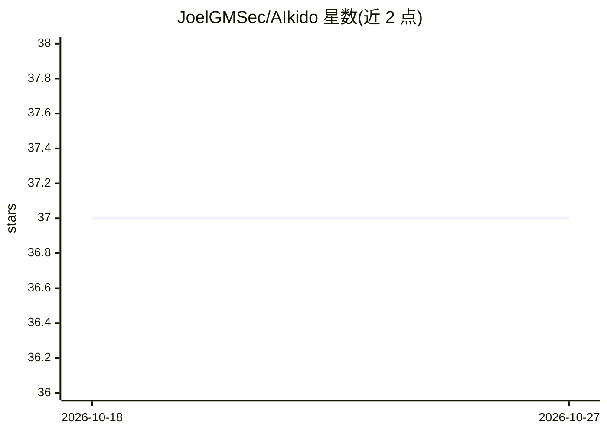

# JoelGMSec/AIkido

⭐ 37 · Python · GPL-3.0 · 推送 2026-08-05 · [GitHub](https://github.com/JoelGMSec/AIkido) · [官网](https://darkbyte.net) · 个人维护

**红队测试用 OpenAI 兼容假 API 服务器**

AIkido 是一个伪造的 OpenAI 兼容 API 服务器，用于测试、研究与红队演练。后端可接入真实 ChatGPT（经 nodriver）或任意 OpenAI/Ollama 兼容 REST API，也可仅模拟 API key 验证。提供 Web 聊天界面、HTTP/2 与自签名 SSL、请求/响应 JSON 转储日志、payload 注入模拟（测试 LLM 供应链与不安全 eval 场景）。Python 3.8+ 编写，GPL-3.0 许可，声明仅限教育与授权安全审计用途。

## 筛选速览

| 维度 | 判定 | 备注 |
|---|---|---|
| AI 角色 | `ai-ecosystem` | LLM/agent 周边工具 |
| 许可风险 | `viral` | GPL-3.0 |
| 部署形态 | `None` |  |
| 模型依赖 | local-ok | 支持本地模型 |
| 硬件要求 | — | 无带数字的原话,不猜 |
| 安装摩擦 | `low` | 无编译、无系统依赖或容器化 |
| 成熟度 | — | 结构信号不足 |

## 能力要点

- OpenAI 兼容 API 的直接替换（drop-in）伪造服务器
- 多后端：ChatGPT（nodriver）或 OpenAI/Ollama 兼容 API
- 代码注入模拟用于 LLM 供应链/不安全 eval 测试
- HTTP/2 + 自签名 SSL、请求转储日志、假 API key 校验

## 适用场景

- 红队演练中搭建可控的假 AI API 端点
- 测试应用对 LLM 响应注入与供应链攻击的防御
- 审计/分析应用与 AI API 间的请求响应流量

## 场景标签

`网络安全` · 领域:学习与行业

## 证据(README 行号)

> L7: **AIkido** is a fake OpenAI-compatible API server that integrates real **ChatGPT** (via `nodriver`) and supports mul
> L12: - ⚡ **Multi-backend support**: Choose between ChatGPT (NoDriver) or OpenAI/Ollama compatible REST API.

## 星数曲线

2026-10-18 37 → 2026-10-27 37（+0）

---
*卡片 v1 · prompt 1.4 · 生成 2026-10-25 · 置信度 high · 依据 README sha `7610ca407b61` · [字段定义](../../DATASET.md)*
