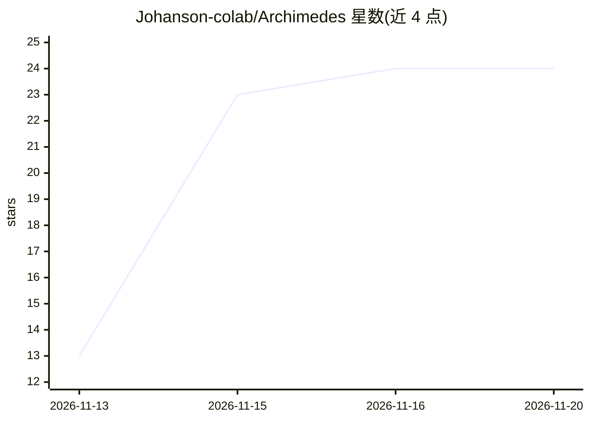

# Johanson-colab/Archimedes

⭐ 24 · JavaScript · 推送 2026-11-19 · [GitHub](https://github.com/Johanson-colab/Archimedes) · 组织维护 · 中文 README

**本地优先的科研 agent 工作台：文献发现、代码复现到写作**

以 Electron 桌面应用形式运行的科研代理套件，围绕“问题→来源→证据→实现→实验→写作”的研究循环组织功能：论文发现与 PDF 阅读（笔记/高亮/翻译/溯源讨论）、关联代码仓库的复现工作流、数据分析与 LaTeX 写作、集成终端。模型与搜索提供商可配置（OpenAI 兼容端点；搜索可选 Brave/Tavily/Exa/Firecrawl），工作区数据默认本地保存，agent 的文件写入与 shell 命令需人工批准。实验谱系与证据溯源仍在开发中，图像生成尚未接入。

## 筛选速览

| 维度 | 判定 | 备注 |
|---|---|---|
| AI 角色 | `ai-native` | 本体是模型或模型工具 |
| 许可风险 | `none` | — |
| 部署形态 | `library` | 以包/库形式分发 |
| 模型依赖 | — | README 未给出锁定关系 |
| 硬件要求 | — | 无带数字的原话,不猜 |
| 安装摩擦 | `low` | 无编译、无系统依赖或容器化 |
| 成熟度 | `idea` | |

## 能力要点

- 研究循环五阶段工作流（定义/发现阅读/复现/分析写作/回顾）
- 模型与搜索提供商独立配置，不锁定单一厂商
- 本地优先：工作区数据存本地，凭据保留在 Electron 主进程
- agent 的文件写入与 shell 命令需人工批准

## 适用场景

- 在统一工作区里做文献发现、阅读与笔记管理
- 沿论文追到代码仓库并准备复现实验
- 配置自选模型与搜索提供商完成数据分析与论文写作

## 场景标签

`科研工具` `知识库管理` `数据分析` · 领域:效率与自动化

## 证据(README 行号)

> L6: > A local-first research-agent suite for discovering evidence, reading papers, inspecting code, running research wor
> L68: - **Research Apps** — bring focused tools into a shared workspace for literature discovery, paper reading, reproduc

## 星数曲线

2026-11-13 13 → 2026-11-20 24（+11）

---
*卡片 v1 · prompt 1.4 · 生成 2026-11-18 · 置信度 high · 依据 README sha `1a378ac9c0f1` · [字段定义](../../DATASET.md)*
