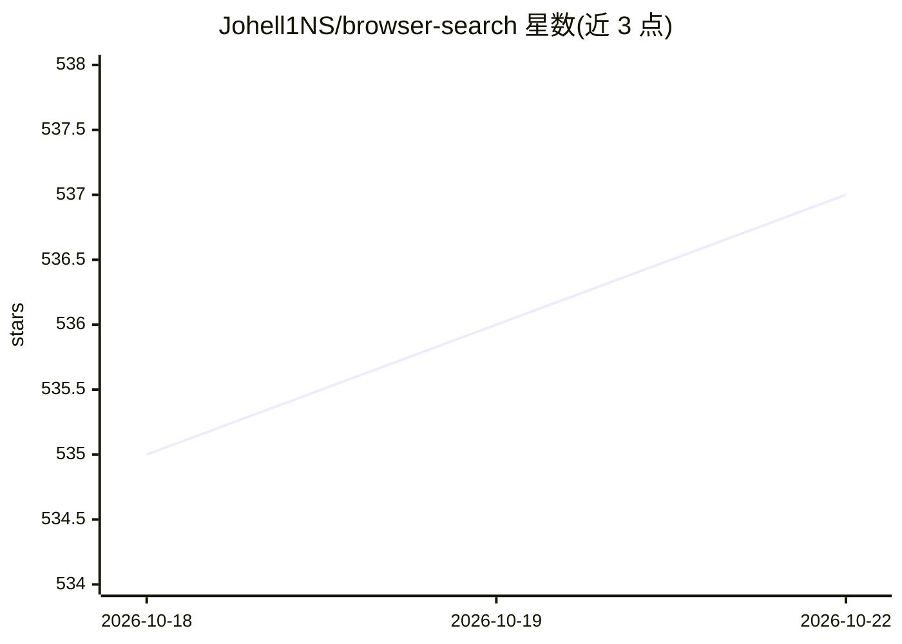

# Johell1NS/browser-search

⭐ 538 · JavaScript · MIT · 推送 2026-10-22 · [GitHub](https://github.com/Johell1NS/browser-search) · [官网](https://github.com/Johell1NS/browser-search#readme) · 个人维护 · 中文 README

**给 AI agent 的网页搜索+浏览+反爬绕过技能包**

面向 OpenCode、Claude Code、Cursor 等 AI agent 的 SKILL.md 技能包：通过三阶段流程让 agent 检索与浏览网页——SearXNG 元搜索（Docker 容器、JSON 输出）、Camofox REST 浏览标准站点（含 Readability.js 正文提取）、CloakBrowser 应对 Cloudflare/Akamai/DataDome 等反爬站点，agent 被阻断时自动升级工具。强制使用确定性脚本，模型只做工具选择，执行由脚本完成。安装方式为 npx skills add 或 git clone，需手动 npm install 与运行 Docker 容器。

## 筛选速览

| 维度 | 判定 | 备注 |
|---|---|---|
| AI 角色 | `ai-ecosystem` | LLM/agent 周边工具 |
| 许可风险 | `permissive` | MIT |
| 部署形态 | `library` | 以包/库形式分发 |
| 模型依赖 | — | README 未给出锁定关系 |
| 硬件要求 | — | 无带数字的原话,不猜 |
| 安装摩擦 | `low` | 无编译、无系统依赖或容器化 |
| 成熟度 | — | 结构信号不足 |

## 能力要点

- 三阶段流程：SearXNG 搜索 → Camofox 浏览 → CloakBrowser 绕过反爬
- 确定性脚本执行，模型仅做工具选择，不能出错命令或误读输出
- Camofox 含 Readability.js 正文提取，宣称约减少 70% token
- 自托管运行，无需付费 API key，可在树莓派等低功耗硬件上运行

## 适用场景

- 让我的 AI agent 在回答前先搜索并核验实时网页信息
- agent 需要访问带 Cloudflare 等反爬保护的网站内容
- 低成本自托管方案替代付费搜索/浏览 API

## 场景标签

`浏览器自动化` `网页抓取` · 领域:效率与自动化

## 证据(README 行号)

> L13: > **A skill for AI agents.** OpenCode, Claude Code, Cursor, OpenClaw and
> L30: The skill enforces the exclusive use of deterministic scripts.

## 星数曲线

2026-10-18 535 → 2026-10-22 537（+2）

---
*卡片 v1 · prompt 1.4 · 生成 2026-10-21 · 置信度 mid · 依据 README sha `914cc81baee2` · [字段定义](../../DATASET.md)*
