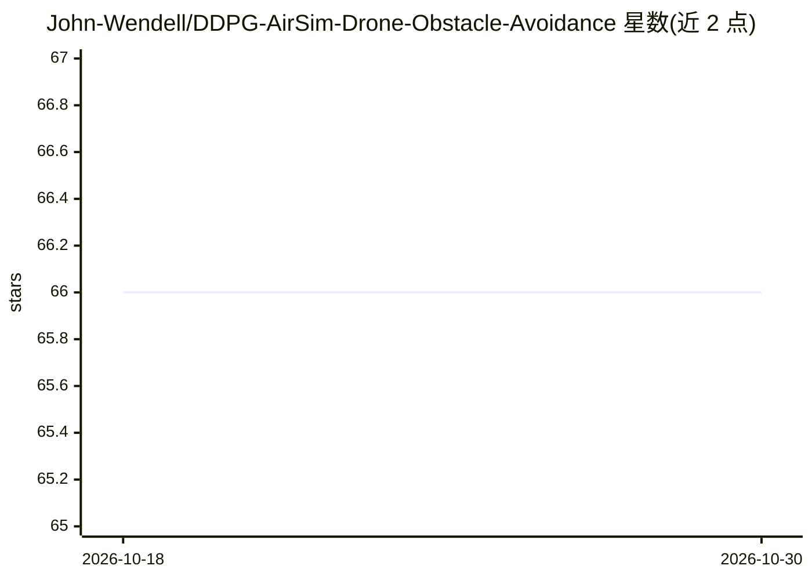

# John-Wendell/DDPG-AirSim-Drone-Obstacle-Avoidance

⭐ 66 · Python · MIT · 推送 2025-11-03 · [GitHub](https://github.com/John-Wendell/DDPG-AirSim-Drone-Obstacle-Avoidance) · 个人维护 · 中文 README

**DDPG+ConvLSTM 控制无人机在 AirSim 中避障的研究代码**

基于 Microsoft AirSim 仿真环境的强化学习项目：用 DDPG 算法结合 ConvLSTM，输入前 4 个时刻及当前的 64x64 深度图像、高度状态与动作序列，输出高度方向控制指令，实现无人机垂直方向避障。Actor 与 Critic 均采用图像/状态/动作分支结构，batch size 为 32。使用时先启动 AirSim 仿真，再运行 main.py 训练、test.py 测试。作者声明这是哈尔滨工业大学（深圳）硕士课程作业，未充分调参且存在缺陷。

## 筛选速览

| 维度 | 判定 | 备注 |
|---|---|---|
| AI 角色 | `ai-native` | 本体是模型或模型工具 |
| 许可风险 | `permissive` | MIT |
| 部署形态 | `None` |  |
| 模型依赖 | — | README 未给出锁定关系 |
| 硬件要求 | — | 无带数字的原话,不猜 |
| 安装摩擦 | `low` | 无编译、无系统依赖或容器化 |
| 成熟度 | `idea` | |

## 能力要点

- DDPG + ConvLSTM 的 Actor-Critic 结构
- 输入为时序深度图像（64x64）与高度状态序列
- 输出高度方向控制指令实现垂直避障
- 在 AirSim 1.2.0 仿真环境中训练与测试

## 适用场景

- 在 AirSim 仿真中做无人机避障的强化学习实验
- 复现或改进基于时序深度图像的 DDPG 控制
- 课程作业或入门强化学习无人机控制的参考实现

## 场景标签

`强化学习` · 领域:训练与推理

## 证据(README 行号)

> L2: Using DDPG and ConvLSTM to control a drone to avoid obstacle in AirSim
> L44: 1. run `AirSim` to start the simulation enviroment

## 星数曲线

2026-10-18 66 → 2026-10-30 66（+0）

---
*卡片 v1 · prompt 1.4 · 生成 2026-10-24 · 置信度 high · 依据 README sha `223c91113234` · [字段定义](../../DATASET.md)*
