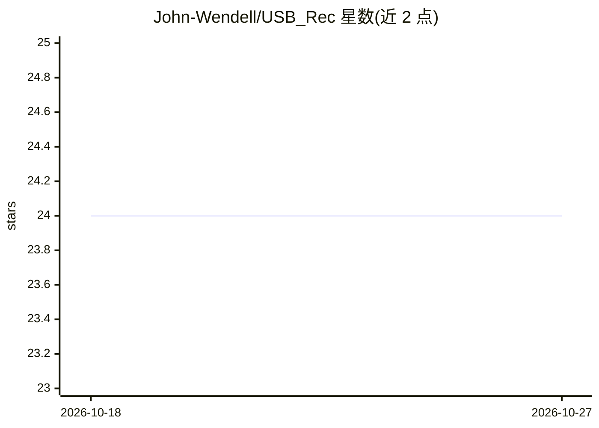

# John-Wendell/USB_Rec

⭐ 24 · Python · 推送 2026-03-13 · [GitHub](https://github.com/John-Wendell/USB_Rec) · 个人维护

**Recsys'25 论文 USB-Rec 官方代码：多智能体强化学习提升 LLM 对话推荐**

论文《USB-Rec: An Effective Framework for Improving Conversational Recommendation Capability of Large Language Model》的官方代码库。框架分 PODCS 与 SES 两部分，通过 notebook 运行并输出结果文件；LLM 可选本地部署或开源模型，通过 api_key 与 base_url 接入，训练环节使用 llama-factory。数据集来自 iEval，附 bibtex 引用信息。README 信息较简略，缺少完整安装步骤。

## 筛选速览

| 维度 | 判定 | 备注 |
|---|---|---|
| AI 角色 | `ai-native` | 本体是模型或模型工具 |
| 许可风险 | `none` | — |
| 部署形态 | `None` |  |
| 模型依赖 | — | README 未给出锁定关系 |
| 硬件要求 | — | 无带数字的原话,不猜 |
| 安装摩擦 | `low` | 无编译、无系统依赖或容器化 |
| 成熟度 | — | 结构信号不足 |

## 能力要点

- PODCS 与 SES 两个模块，分别以 notebook 运行并输出 jsonl 结果
- LLM 支持本地部署或通过 api_key/base_url 接入开源模型
- 使用 llama-factory 部署 LLM 训练
- 数据集来自 iEval

## 适用场景

- 复现论文中的对话推荐实验
- 基于多智能体强化学习研究 LLM 对话推荐
- 扩展或对比 iEval 数据集上的推荐方法

## 场景标签

`推荐系统` `强化学习` · 领域:学习与行业

## 证据(README 行号)

> L3: The official code of Recsys'25 paper 'USB-Rec: An Effective Framework for Improving Conversational Recommendation Ca
> L16: We deploy llama-factory to training the LLMs.

## 星数曲线

2026-10-18 24 → 2026-10-27 24（+0）

---
*卡片 v1 · prompt 1.4 · 生成 2026-10-27 · 置信度 high · 依据 README sha `2fcde968c4be` · [字段定义](../../DATASET.md)*
