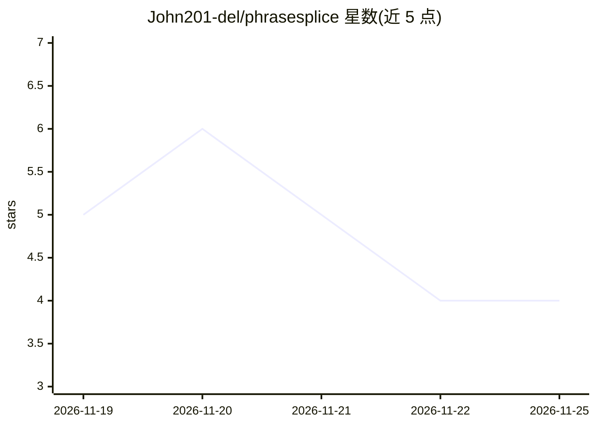

# John201-del/phrasesplice

⭐ 4 · C++ · GPL-3.0 · 推送 2026-11-17 · [GitHub](https://github.com/John201-del/phrasesplice) · 个人维护 · 中文 README

**面向创作者的自然语言 AI 视频剪辑工作台**

PhraseSplice 是一个本地优先的 AI 剪辑应用：导入视频、音频、图片后，用自然语言描述剪辑要求，AI 将指令落到可保存、可撤销的多轨时间线工程上，支持插入、分割、修剪、移动、字幕与效果调整。语言助手可选 Codex、兼容 API 或本地 Ollama，也可经 MCP 由 WorkBuddy 控制；剪辑与导出在本机执行。手工剪辑不要求 AI 账号。当前为开发预览版，首先支持 Windows x64，MLT 运行路径不支持中文目录。

## 筛选速览

| 维度 | 判定 | 备注 |
|---|---|---|
| AI 角色 | `ai-native` | 本体是模型或模型工具 |
| 许可风险 | `viral` | GPL-3.0 |
| 部署形态 | `None` |  |
| 模型依赖 | local-ok | 支持本地模型 |
| 硬件要求 | — | 无带数字的原话,不猜 |
| 安装摩擦 | `low` | 无编译、无系统依赖或容器化 |
| 成熟度 | `idea` | |

## 能力要点

- 自然语言指令落到可保存、可撤销的原生多轨时间线工程
- AI 后端可选 Codex、DeepSeek、通义千问、豆包火山方舟、Ollama 或自定义兼容接口
- 8 个内置剪辑模板与本地图片/视频处理（磨皮、抠图、人声分离、卡通跟脸）
- 云端提供文生视频（LTX/Seedance）、普通话配音与在线素材检索

## 适用场景

- 用一句话把多个素材按顺序拼接成片并加字幕
- 口播视频剪辑、包装与配音制作
- 照片生成推拉运镜成片或口型同步说话视频
- 自动剪辑后切换到多轨时间线手工精修

## 场景标签

`视频生成` `图像视频处理` · 领域:内容生成

## 证据(README 行号)

> L5: **把想法说清楚，让 AI 帮你剪；时间线上的修改，能看、能改、能撤销。** PhraseSplice 是面向创作者的 AI 剪辑工作台，用日常语言编排素材、剪口播、加字幕、套模板，得到可以继续编辑的多轨工程。
> L35: |**自然语言指令 → 原生时间线**|插入、分割、修剪、移动、字幕和效果调整落到实际片段上|
> L103: 剪辑指令由选定的 AI 理解，时间线修改和导出在本机执行。免费公共视频通道失败后不会自动切换到付费接口。模板套用和照片口型同步分别使用内置模板和可选本地模型。详见 AI 接入指南 与 验证范围。

## 星数曲线

2026-11-19 5 → 2026-11-25 4（-1）

---
*卡片 v1 · prompt 1.4 · 生成 2026-11-20 · 置信度 high · 依据 README sha `621d0ce683e4` · [字段定义](../../DATASET.md)*
