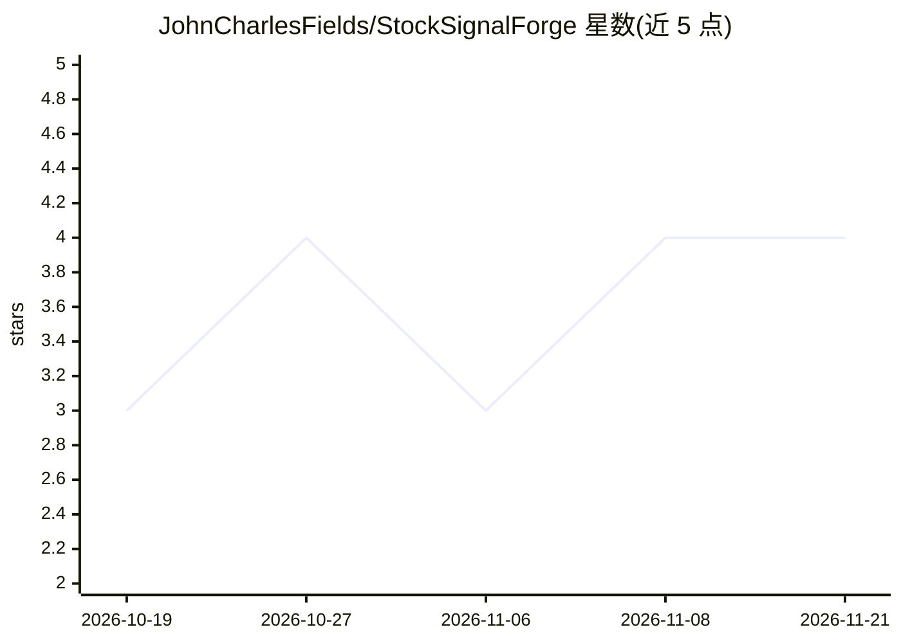

# JohnCharlesFields/StockSignalForge

⭐ 4 · Python · MIT · 推送 2026-10-20 · [GitHub](https://github.com/JohnCharlesFields/StockSignalForge) · [官网](https://github.com/JohnCharlesFields/StockSignalForge/blob/main/SCREENSHOTS.md) · 个人维护 · 中文 README

**面向个人投资者的 AI 股票研究工作台**

基于 HKUDS/Vibe-Trading 框架构建的美股研究平台，整合行情、新闻、回调候选筛选、个股分析、期权方向研究、持仓复盘与策略回测等模块。三层信号体系（机会质量、启动时点、事件风险）产出研究结论；数据源经 MCP 与各类行情 provider 配置接入，缺失数据保持未知而非填充。不连接券商、不下实单；A 股与港股仍在适配中。

## 筛选速览

| 维度 | 判定 | 备注 |
|---|---|---|
| AI 角色 | `ai-native` | 本体是模型或模型工具 |
| 许可风险 | `permissive` | MIT |
| 部署形态 | `self-host` | docker 或自建部署 |
| 模型依赖 | — | README 未给出锁定关系 |
| 硬件要求 | — | 无带数字的原话,不猜 |
| 安装摩擦 | `low` | 无编译、无系统依赖或容器化 |
| 成熟度 | `idea` | |

## 能力要点

- 一站式研究工作台：筛选、个股分析、期权、新闻、持仓复盘、回测
- 三层信号体系与校准概率、SPY 相对 alpha 等多种度量
- GilData MCP 作为可选证据源接入
- 发布版本通过 3,321 项测试的 GitHub CI

## 适用场景

- 每日美股回调候选筛选与个股深度研判
- 期权方向研究与 60–90 DTE 合约情景推演
- 持仓复盘并比对带日期的证据
- 因子研究与策略回测验证

## 场景标签

`金融量化` · 领域:学习与行业

## 证据(README 行号)

> L9: An AI stock research workbench built on HKUDS/Vibe-Trading. Quotes, news, pullback candidate screening, single-stock
> L33: |Three-layer signals|Opportunity quality, launch timing/tunnel structure, event risk and qualified GEX evidence|
> L80: |Model provider|`agent/.env`: `LANGCHAIN_PROVIDER`, `LANGCHAIN_MODEL_NAME` and your provider credentials|

## 星数曲线

2026-10-19 3 → 2026-11-21 4（+1）

---
*卡片 v1 · prompt 1.4 · 生成 2026-11-21 · 置信度 high · 依据 README sha `b5495a458c63` · [字段定义](../../DATASET.md)*
