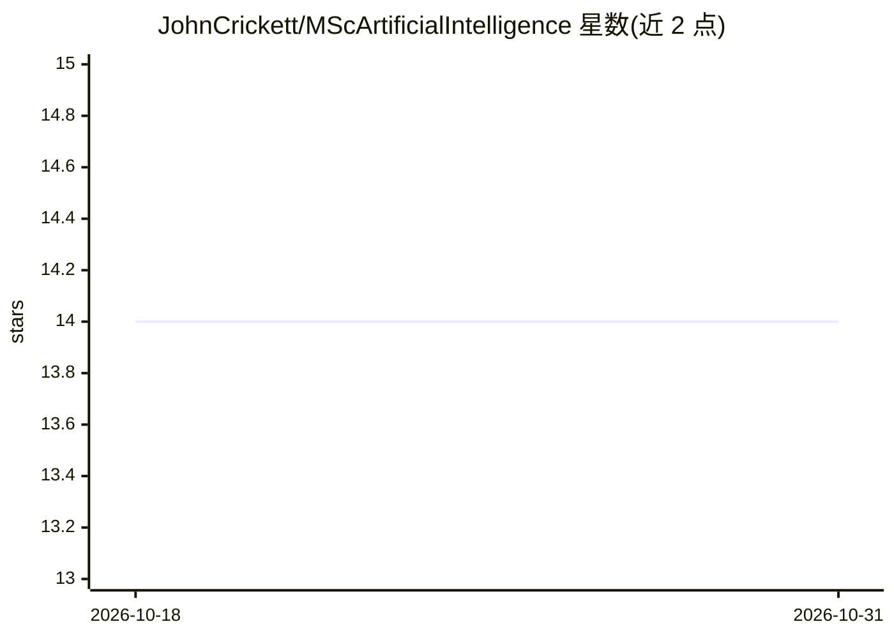

# JohnCrickett/MScArtificialIntelligence

⭐ 14 · JavaScript · 推送 2026-07-11 · [GitHub](https://github.com/JohnCrickett/MScArtificialIntelligence) · [官网](https://mastersartificialintelligence.fyi/) · 个人维护

**全球人工智能硕士（MSc AI）学位课程策展清单**

由 John Crickett 维护的人工智能硕士课程目录网站（mastersartificialintelligence.fyi）的配套清单，按全日制（英国、欧洲、美国）、非全日制与在线/远程学习分组，收录帝国理工、剑桥、爱丁堡、UCL、斯坦福、MIT、佐治亚理工等院校的 MSc/MPhil/MS 课程，部分条目标注学制、转换课程（无需计算机背景）、在线渠道（Coursera/edX）与学费信息。纯目录内容，无可安装组件。

## 筛选速览

| 维度 | 判定 | 备注 |
|---|---|---|
| AI 角色 | `ai-knowledge` | 知识聚合/清单类 |
| 许可风险 | `none` | — |
| 部署形态 | `None` |  |
| 模型依赖 | — | README 未给出锁定关系 |
| 硬件要求 | — | 无带数字的原话,不猜 |
| 安装摩擦 | `low` | 无编译、无系统依赖或容器化 |
| 成熟度 | — | 结构信号不足 |

## 能力要点

- 覆盖英国、欧洲、美国全日制课程及非全日制选项
- 含多所院校的完全在线/远程学习课程与转换课程标注
- 配套网站 mastersartificialintelligence.fyi

## 适用场景

- 查找英国/欧洲/美国的 AI 硕士项目
- 比较在线与远程学习的 MSc AI 选项
- 寻找无需计算机背景的转换课程

## 场景标签

`精选清单` · 领域:学习与行业

## 证据(README 行号)

> L5: # MSc Artificial Intelligence Degree Courses
> L7: A curated directory of MSc Artificial Intelligence degree courses worldwide.

## 星数曲线

2026-10-18 14 → 2026-10-31 14（+0）

---
*卡片 v1 · prompt 1.4 · 生成 2026-10-31 · 置信度 high · 依据 README sha `e8122eca5192` · [字段定义](../../DATASET.md)*
