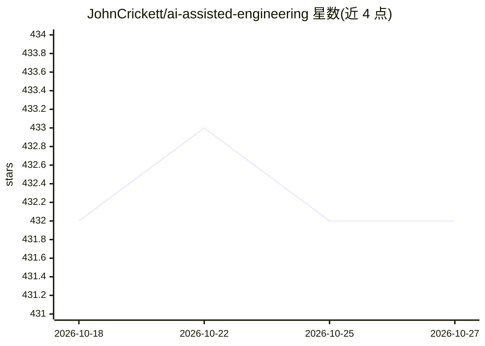

# JohnCrickett/ai-assisted-engineering

⭐ 432 · 推送 2026-03-13 · [GitHub](https://github.com/JohnCrickett/ai-assisted-engineering) · 个人维护

**AI 辅助软件工程指南：面向工程师与工程负责人**

由 John Crickett 维护的 AI 辅助软件工程参考指南，内容按 How To 指南（需求）、通用指南（AGENTS.md、编码代理技能、提示工程）与资源（AI 编码工具、AI 代码审查工具、厂商指南、课程、公司博客、演讲与书籍）分节组织，服务于需要采用基于 LLM 开发工具的软件工程师与工程管理者。以仓库文档形式提供，无安装步骤。

## 筛选速览

| 维度 | 判定 | 备注 |
|---|---|---|
| AI 角色 | `ai-knowledge` | 知识聚合/清单类 |
| 许可风险 | `none` | — |
| 部署形态 | `None` |  |
| 模型依赖 | — | README 未给出锁定关系 |
| 硬件要求 | — | 无带数字的原话,不猜 |
| 安装摩擦 | `low` | 无编译、无系统依赖或容器化 |
| 成熟度 | — | 结构信号不足 |

## 能力要点

- 按 How To 指南、通用指南、资源三大板块组织
- 覆盖 AGENTS.md、编码代理技能、提示工程等主题
- 汇集 AI 编码工具、代码审查工具与厂商指南等资源清单

## 适用场景

- 查找 AI 辅助编码的实践指南与资源
- 了解 AGENTS.md 与编码代理技能的用法
- 为团队选型 AI 编码工具时参考资源清单

## 场景标签

`精选清单` `教程课程` · 领域:学习与行业

## 证据(README 行号)

> L6: A guide to AI-assisted software engineering.
> L11: ## Sections

## 星数曲线

2026-10-18 432 → 2026-10-27 432（+0）

---
*卡片 v1 · prompt 1.4 · 生成 2026-10-21 · 置信度 high · 依据 README sha `5a43e27a724a` · [字段定义](../../DATASET.md)*
