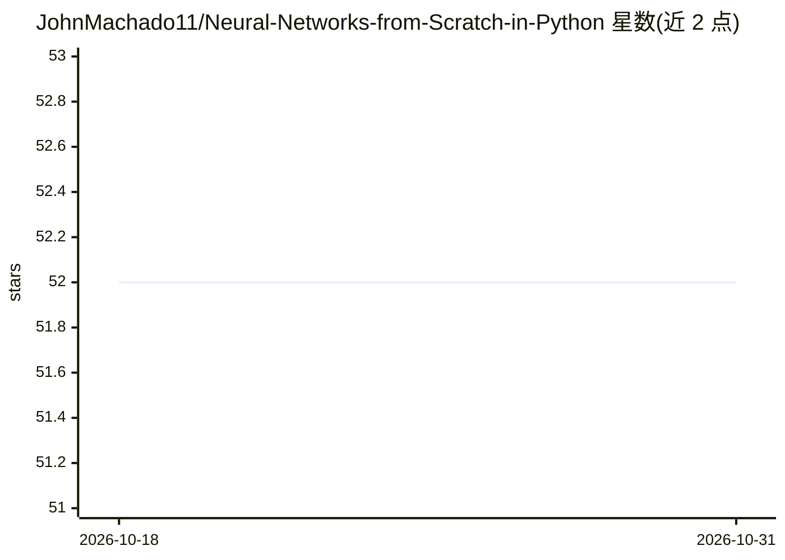

# JohnMachado11/Neural-Networks-from-Scratch-in-Python

⭐ 52 · Python · 推送 2026-05-11 · [GitHub](https://github.com/JohnMachado11/Neural-Networks-from-Scratch-in-Python) · [官网](https://nnfs.io/) · 个人维护

**《Neural Networks From Scratch》书的配套代码库**

Harrison Kinsley 与 Daniel Kukiela 所著《Neural Networks From Scratch》一书的代码仓库，仅用 Python 和 NumPy 从零实现神经网络，内容覆盖神经元编码、层组织、激活函数、损失计算、反向传播与参数优化。README 提供配套书站与神经网络动画资源链接，以及原书仓库地址。

## 筛选速览

| 维度 | 判定 | 备注 |
|---|---|---|
| AI 角色 | `ai-knowledge` | 知识聚合/清单类 |
| 许可风险 | `none` | — |
| 部署形态 | `None` |  |
| 模型依赖 | — | README 未给出锁定关系 |
| 硬件要求 | — | 无带数字的原话,不猜 |
| 安装摩擦 | `low` | 无编译、无系统依赖或容器化 |
| 成熟度 | — | 结构信号不足 |

## 能力要点

- 仅用 Python 与 NumPy 从零实现神经网络
- 覆盖激活函数、损失计算、反向传播与参数优化

## 适用场景

- 跟书学习神经网络的底层实现原理
- 参考无深度学习框架依赖的教学代码

## 场景标签

`教程课程` · 领域:学习与行业

## 证据(README 行号)

> L7: "Neural Networks From Scratch is a book intended to teach you how to build neural networks on your own, without any 
> L9: By Harrison Kinsley & Daniel Kukiela

## 星数曲线

2026-10-18 52 → 2026-10-31 52（+0）

---
*卡片 v1 · prompt 1.4 · 生成 2026-10-25 · 置信度 mid · 依据 README sha `f78ed5d8066b` · [字段定义](../../DATASET.md)*
