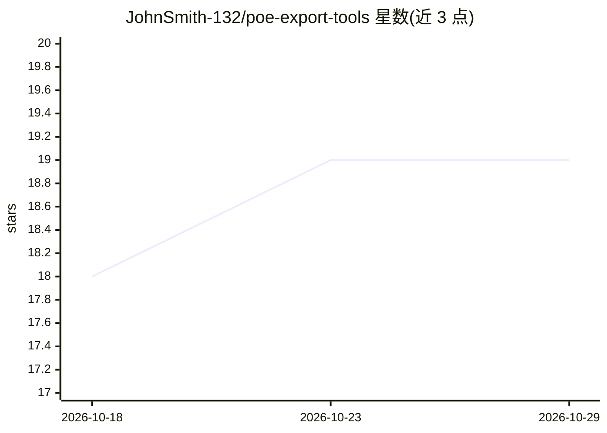

# JohnSmith-132/poe-export-tools

⭐ 19 · TypeScript · MIT · 推送 2026-08-06 · [GitHub](https://github.com/JohnSmith-132/poe-export-tools) · [官网](https://export.tools) · 个人维护

**从 Poe 聊天分享链接浏览并下载媒体附件的 Web 应用**

基于 Bun + TypeScript 的全栈 Web 应用：粘贴 Poe 分享链接（poe.com/s/<id>）后，从页面提取附件 URL，以媒体网格或聊天记录两种视图浏览图片与视频，可将全部附件连同 next-data.json 打包成 zip 在浏览器内完成压缩下载；支持上传已保存的 next-data.json 离线重开导出。安装方式为 git clone 后 bun install，可本地运行或构建二进制部署到 Railway。仓库 legacy/ 目录保留原 Selenium 脚本但已不再维护。

## 筛选速览

| 维度 | 判定 | 备注 |
|---|---|---|
| AI 角色 | `ai-enhanced` | 去掉 AI 部分产品仍成立 |
| 许可风险 | `permissive` | MIT |
| 部署形态 | `None` |  |
| 模型依赖 | — | README 未给出锁定关系 |
| 硬件要求 | — | 无带数字的原话,不猜 |
| 安装摩擦 | `low` | 无编译、无系统依赖或容器化 |
| 成熟度 | — | 结构信号不足 |

## 能力要点

- 从 Poe 分享链接提取并展示图片与视频附件
- 网格视图与聊天记录视图两种浏览方式
- zip 打包下载，压缩在浏览器端完成
- 可上传 next-data.json 离线重开历史导出

## 适用场景

- 保存自己在 Poe 分享的聊天里的图片和视频
- 以聊天记录形式回顾并导出分享对话的完整附件
- 离线查看之前导出的 Poe 会话数据

## 场景标签

`网页抓取` · 领域:效率与自动化

## 证据(README 行号)

> L25: export.tools extracts attachment URLs from Poe share links. Paste a `https://poe.com/s/<id>` URL, browse the media 
> L29: - Paste a Poe share URL and see every attachment inline (images + videos)

## 星数曲线

2026-10-18 18 → 2026-10-29 19（+1）

---
*卡片 v1 · prompt 1.4 · 生成 2026-10-29 · 置信度 mid · 依据 README sha `5e871b048047` · [字段定义](../../DATASET.md)*
