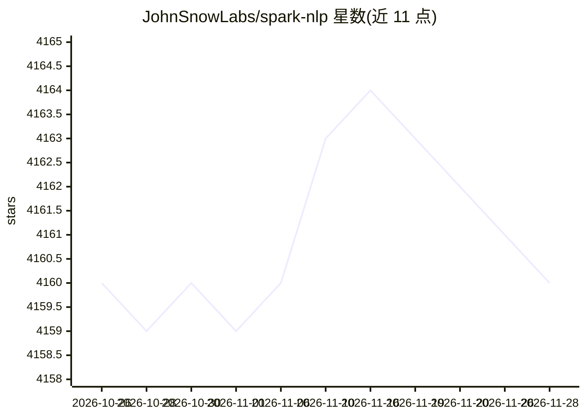

# JohnSnowLabs/spark-nlp

⭐ 4,160 · Scala · Apache-2.0 · 推送 2026-11-27 · [GitHub](https://github.com/JohnSnowLabs/spark-nlp) · [官网](https://sparknlp.org/) · 组织维护

**给开发者提供基于 Apache Spark 的分布式 NLP 与 LLM 推理库**

构建在 Apache Spark 之上的 NLP 库，为机器学习流水线提供分词、词性标注、命名实体识别、翻译、摘要、问答、文本生成、语音识别、图像分类等任务能力，内置 100000+ 预训练流水线与模型、覆盖 200+ 语言。可从 TensorFlow、ONNX、OpenVINO、Llama.cpp (GGUF) 导入模型，向 Python、R 与 JVM 生态（Java/Scala/Kotlin）暴露接口；提供 Maven、PyPI/Anaconda 包与离线使用方式，兼容 Databricks、Amazon EMR、Dataproc 等平台。

## 筛选速览

| 维度 | 判定 | 备注 |
|---|---|---|
| AI 角色 | `ai-native` | 本体是模型或模型工具 |
| 许可风险 | `permissive` | Apache-2.0 |
| 部署形态 | `library` | 以包/库形式分发 |
| 模型依赖 | local-ok | 支持本地模型 |
| 硬件要求 | — | 无带数字的原话,不猜 |
| 安装摩擦 | `medium` | 含编译或系统依赖之一 |
| 成熟度 | — | 结构信号不足 |

## 能力要点

- 提供 Tokenization、NER、机器翻译、摘要、问答、语音识别等多类 NLP/多模态任务
- 预训练流水线与模型 100000+，覆盖 200+ 语言
- 支持从 TensorFlow、ONNX、OpenVINO、Llama.cpp (GGUF) 导入模型
- 支持 Python、R 与 JVM（Java/Scala/Kotlin），兼容 Databricks/EMR/Dataproc

## 适用场景

- 在 Spark 集群上大规模运行命名实体识别、文本分类等 NLP 流水线
- 用 JVM（Java/Scala/Kotlin）在分布式环境调用预训练 NLP 模型
- 在 Databricks/EMR 平台上部署 NLP 训练与推理任务
- 离线环境下加载预训练模型处理多语言文本

## 场景标签

`推理引擎` `语音识别` · 领域:感知与多模态

## 证据(README 行号)

> L20: Spark NLP is a state-of-the-art Natural Language Processing library built on top of Apache Spark. It provides **sim
> L23: It also offers tasks such as **Tokenization**, **Word Segmentation**, **Part-of-Speech Tagging**, Word and Sentence
> L25: **Spark NLP** is the only open-source NLP library in **production** that offers state-of-the-art transformers such 

## 星数曲线

2026-10-26 4,160 → 2026-11-28 4,160（+0）

---
*卡片 v1 · prompt 1.4 · 生成 2026-11-23 · 置信度 high · 依据 README sha `ee259fee665b` · [字段定义](../../DATASET.md)*
