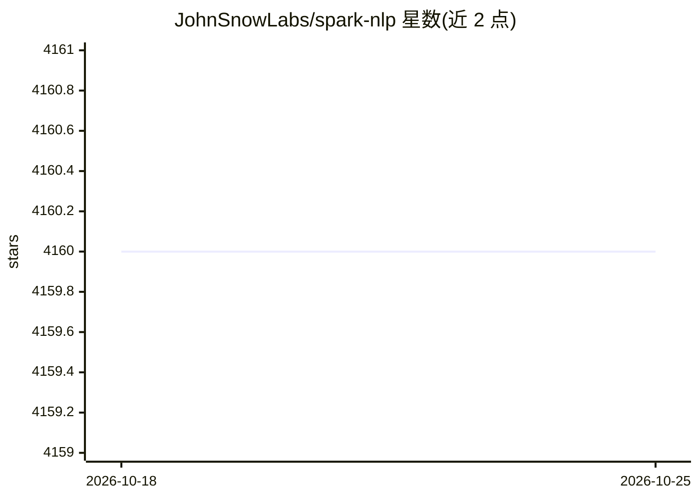

# JohnSnowLabs/spark-nlp

⭐ 4,160 · Scala · Apache-2.0 · 推送 2026-10-23 · [GitHub](https://github.com/JohnSnowLabs/spark-nlp) · [官网](https://sparknlp.org/) · 组织维护

**基于 Apache Spark 的 NLP 与 LLM 库：给 Python/JVM 开发者**

构建在 Apache Spark 之上的 NLP 与 LLM 库，面向 Python、Scala、Java、Kotlin 开发者，覆盖分词、词性标注、命名实体识别、情感分析、机器翻译、问答、文本生成、语音识别、图像分类等任务。提供 100000+ 预训练模型与 pipeline，支持 200+ 语言，可导入 TensorFlow、ONNX、OpenVINO、Llama.cpp (GGUF) 模型。兼容 Databricks、Amazon EMR、Dataproc 等平台，支持 GPU 与离线使用；运行需要 Java（Spark 3.x 用 Java 8/11，Spark 4.x 用 Java 17）。

## 筛选速览

| 维度 | 判定 | 备注 |
|---|---|---|
| AI 角色 | `ai-native` | 本体是模型或模型工具 |
| 许可风险 | `permissive` | Apache-2.0 |
| 部署形态 | `library` | 以包/库形式分发 |
| 模型依赖 | local-ok | 支持本地模型 |
| 硬件要求 | — | 无带数字的原话,不猜 |
| 安装摩擦 | `medium` | 含编译或系统依赖之一 |
| 成熟度 | — | 结构信号不足 |

## 能力要点

- 100000+ 预训练模型与 pipeline，支持 200+ 语言
- 任务覆盖 NER、词性标注、机器翻译、问答、ASR、图像分类等
- 可导入 TensorFlow / ONNX / OpenVINO / Llama.cpp (GGUF) 模型
- 同时支持 Python 与 JVM 生态（Java/Scala/Kotlin）及分布式运行

## 适用场景

- 在 Spark 集群上做大规模文本处理与 NER/分类
- 复用预训练模型快速搭建多语言 NLP pipeline
- 在 Databricks / EMR / Dataproc 上运行 NLP 工作负载

## 场景标签

`语音识别` `目标检测` · 领域:感知与多模态

## 证据(README 行号)

> L20: Spark NLP is a state-of-the-art Natural Language Processing library built on top of Apache Spark. It provides **sim
> L23: It also offers tasks such as **Tokenization**, **Word Segmentation**, **Part-of-Speech Tagging**, Word and Sentence
> L25: **Spark NLP** is the only open-source NLP library in **production** that offers state-of-the-art transformers such 

## 星数曲线

2026-10-18 4,160 → 2026-10-25 4,160（+0）

---
*卡片 v1 · prompt 1.4 · 生成 2026-10-20 · 置信度 high · 依据 README sha `5203a3a4258f` · [字段定义](../../DATASET.md)*
