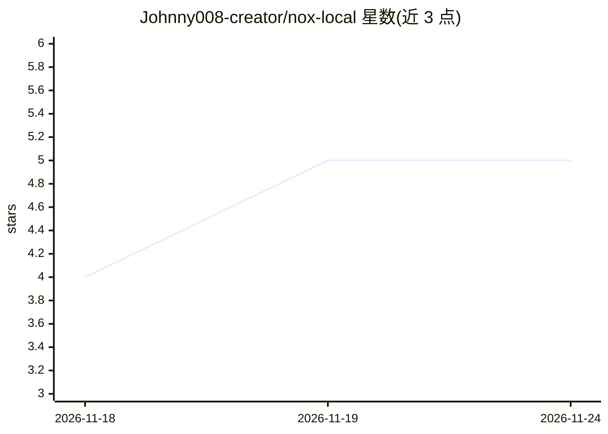

# Johnny008-creator/nox-local

⭐ 5 · Go · MIT · 推送 2026-11-17 · [GitHub](https://github.com/Johnny008-creator/nox-local) · 个人维护

**本地终端编码 agent：驱动 llama.cpp 在自有 GPU 上离线写代码**

Go 编写的终端 TUI 编码 agent，直接驱动 llama.cpp（Vulkan）运行本地 GGUF 模型，无需 API key、可完全离线。围绕小模型（4B 级）设计：精简的 10 工具菜单、分块读文件与输出裁剪、纯文本工具调用恢复、循环护栏与思考预算。支持 manual/plan/auto/yolo 四种审批模式、Git 检查点回滚、MCP 服务器按需开关、SKILL.md 技能、NOX.md 项目记忆与 headless/CI 用法。需 Linux 与 Vulkan GPU（8 GB VRAM 为测试目标），从源码、二进制或 go install 安装。

## 筛选速览

| 维度 | 判定 | 备注 |
|---|---|---|
| AI 角色 | `ai-native` | 本体是模型或模型工具 |
| 许可风险 | `permissive` | MIT |
| 部署形态 | `library` | 以包/库形式分发 |
| 模型依赖 | local-ok | 支持本地模型 |
| 硬件要求 | — | 无带数字的原话,不猜 |
| 安装摩擦 | `medium` | 含编译或系统依赖之一 |
| 成熟度 | — | 结构信号不足 |

## 能力要点

- 为 4B 小模型重写的 agent 循环：短工具菜单、上下文裁剪、纯文本工具调用恢复
- manual/plan/auto/yolo 四级审批，每次变更显示 diff 并有 Git 检查点回滚
- MCP 服务器按需开关，兼容 .mcp.json 与 ~/.claude/skills 技能目录
- 内测 5 个 GGUF 模型在 RX 6500 XT 8 GB 上的 llama-bench 基准数据

## 适用场景

- 无网络/注重隐私环境下用本地模型改代码
- 低配 GPU 上跑小模型的终端编码助手
- 脚本与 CI 中以 headless 模式调用 agent

## 场景标签

`编码 Agent` · 领域:编码与开发

## 证据(README 行号)

> L3: **A coding agent that runs only on your machine.**
> L16: NØX-Local is a coding agent for people who want the work to stay on their own computer. It drives llama.cpp directl
> L53: - Linux with a Vulkan-capable GPU. 8 GB of VRAM is the tested target; smaller models run on less.

## 星数曲线

2026-11-18 4 → 2026-11-24 5（+1）

---
*卡片 v1 · prompt 1.4 · 生成 2026-11-21 · 置信度 high · 依据 README sha `da50ffa498b3` · [字段定义](../../DATASET.md)*
