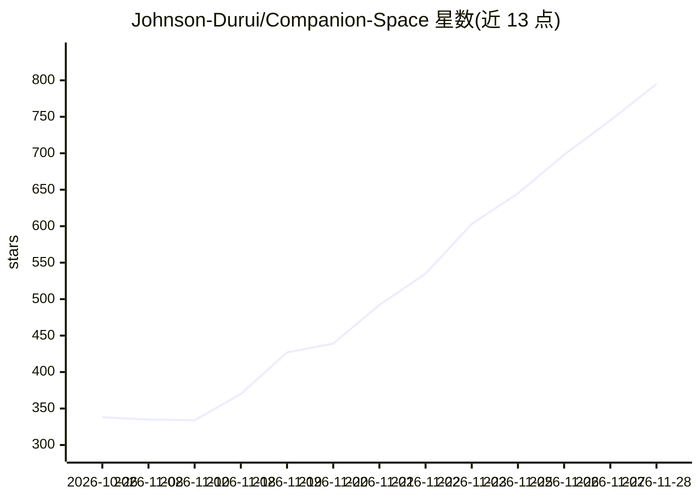

# Johnson-Durui/Companion-Space

⭐ 795 · Python · Apache-2.0 · 推送 2026-11-25 · [GitHub](https://github.com/Johnson-Durui/Companion-Space) · 个人维护 · 中文 README

**给学生的本地二次元 1v1 AI 视频导师，覆盖备课到复习闭环**

本地优先的单进程 FastAPI + React 应用：拖入教材/真题后自动拆解章节考点、对齐教材原页并生成学习计划；提供 6 位带 27/27 全相位 VP9 动态短片的二次元导师，1v1 课堂含参数化交互函数白板、逐行推导、语音互动、独立双轮验算的「问一题」工坊、教材伴读、积木笔记、可溯源学习记忆与 FSRS 复习调度。数据存于本机 SQLite，服务默认仅监听 127.0.0.1。需 1 个大模型 API Key 或本机订阅（Antigravity/Codex/Ollama），动态短片素材受 MiniMax 社区许可约束。

## 筛选速览

| 维度 | 判定 | 备注 |
|---|---|---|
| AI 角色 | `ai-native` | 本体是模型或模型工具 |
| 许可风险 | `permissive` | Apache-2.0 |
| 部署形态 | `desktop` | 安装包/桌面程序 |
| 模型依赖 | local-ok | 支持本地模型 |
| 硬件要求 | — | 无带数字的原话,不猜 |
| 安装摩擦 | `low` | 无编译、无系统依赖或容器化 |
| 成熟度 | — | 结构信号不足 |

## 能力要点

- 6 位导师各含 27 段全相位动态短片与互异 Edge 神经声线，无需第二个语音 Key
- 课程拆解、真题考频统计、教材原页溯源与 FSRS 间隔复习闭环
- 问一题先独立验算再分步引导，客观题由后端代码确定性判分
- 三档形象架构：静态立绘 / 短片包 / 本机 GPU 实时口型（LivePortrait 等）

## 适用场景

- 把自己的教材和历年真题变成可溯源的 1v1 视频课程
- 拍错题截图让 AI 先独立验算再分步讲解
- 在轻薄本上免显卡跑动态导师并做 FSRS 间隔复习
- 全本机留存学习数据与密钥的备考环境

## 场景标签

`RAG` `文档问答` · 领域:知识与检索

## 证据(README 行号)

> L5: 像打视频电话一样的本地二次元 AI 1v1 专属导师 —— 放入你的教材、讲义、笔记和历年真题，在自己电脑上获得**可溯源考情课程地图、6 位 27/27 满配纯视频动态老师、参数化交互同步白板、「问一题」独立解题工坊、沉浸式教材伴
> L30: |**方式 B · 一个 API Key 全包圆**|填入 **1 个** 大模型 API Key（内置 **智谱 BigModel / 硅基流动 / DeepSeek / 阿里云百炼 / 火山方舟 / Kimi / OpenRo
> L73: - **数据与密钥 100% 留在你本机**：

## 星数曲线

2026-10-26 338 → 2026-11-28 795（+457）

---
*卡片 v1 · prompt 1.4 · 生成 2026-11-26 · 置信度 mid · 依据 README sha `3660593bd101` · [字段定义](../../DATASET.md)*
