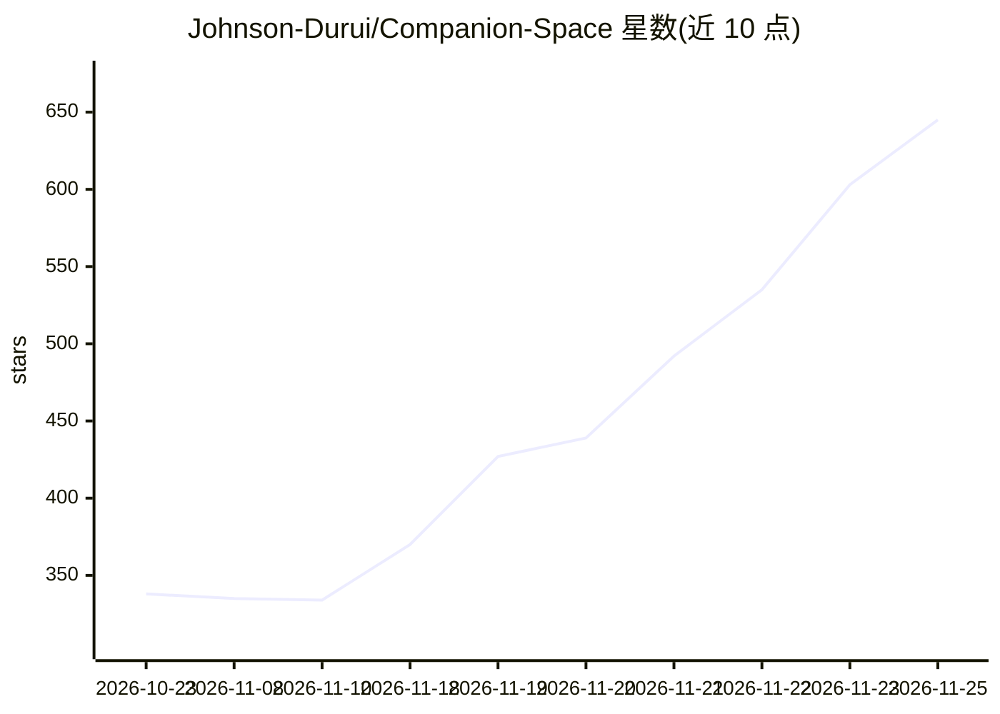

# Johnson-Durui/Companion-Space

⭐ 645 · Python · Apache-2.0 · 推送 2026-11-21 · [GitHub](https://github.com/Johnson-Durui/Companion-Space) · 个人维护 · 中文 README

**给学习者的本地二次元 AI 一对一视频导师**

本地优先的 1v1 AI 导师应用：导入 PDF/PPTX/DOCX/图片/Markdown 等教材资料后，由动态二次元虚拟老师在 9:16 视频通话式窗口中对着同步白板讲课，白板呈现 KaTeX 公式、函数图像、表格与流程图，学生可随时打断追问；课程内容基于 RAG 从用户资料生成并可溯源校对，课后自动生成 FSRS 复习卡与错题回顾。内置 6 位 Apache-2.0 开源的原创导师形象（8 槽位 VP9 动效短片包与 24kHz 干声）。数据保存在本机，模型与语音服务商由用户自行配置。

## 筛选速览

| 维度 | 判定 | 备注 |
|---|---|---|
| AI 角色 | `ai-native` | 本体是模型或模型工具 |
| 许可风险 | `permissive` | Apache-2.0 |
| 部署形态 | `self-host` | docker 或自建部署 |
| 模型依赖 | — | README 未给出锁定关系 |
| 硬件要求 | — | 无带数字的原话,不猜 |
| 安装摩擦 | `low` | 无编译、无系统依赖或容器化 |
| 成熟度 | — | 结构信号不足 |

## 能力要点

- 视频通话式 9:16 动态导师窗口，双 video 180ms 切换、150ms 答题微表情反馈
- 三档形象架构：单图静态立绘 / 循环短片包（默认）/ 本地 GPU 实时驱动 Sidecar
- 同步白板（公式、函数图像、表格、流程图）与语音同步，可随时打断追问
- 内置 .tutorpack 工具链（校验与打包 CLI、ComfyUI 工作流模板）自制导师

## 适用场景

- 用自己的教材和真题让 AI 老师一对一讲课
- 课后按 FSRS 记忆算法自动复习薄弱知识点
- 在本地隐私环境下部署自托管的 AI 学习陪伴应用

## 场景标签

`RAG` `文档问答` · 领域:知识与检索

## 证据(README 行号)

> L5: 导入你的教材、讲义、笔记和真题，让原创动态二次元老师对着同步白板 1 对 1 讲课、随时打断追问、课后用 FSRS 帮着复习。
> L23: - **真正围绕你的资料上课**：直接丢入 PDF、PPTX、DOCX、图片、Markdown 或纯文本，按教材 / 讲义 / 真题整理成**可溯源、可手动校对**的课程地图，再根据学情访谈与摸底安排学习计划。
> L100: 2. **用自己的资料上课**：打开 **「设置 → 模型」** 配置任意 OpenAI 兼容或主流大模型服务商的 API Key（内置支持筛选含免费额度的预设服务商），测试通过后即可导入 PDF / PPTX / DOCX /

## 星数曲线

2026-10-23 338 → 2026-11-25 645（+307）

---
*卡片 v1 · prompt 1.4 · 生成 2026-11-25 · 置信度 mid · 依据 README sha `3b827241286e` · [字段定义](../../DATASET.md)*
