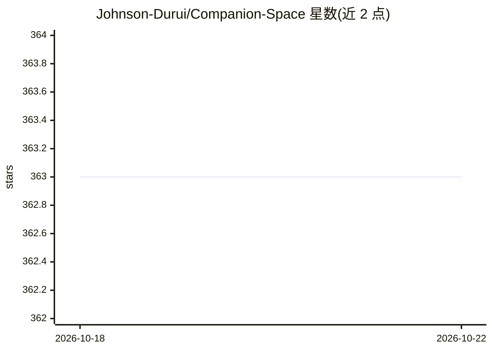

# Johnson-Durui/Companion-Space

⭐ 338 · Python · Apache-2.0 · 推送 2026-09-23 · [GitHub](https://github.com/Johnson-Durui/Companion-Space) · 个人维护 · 中文 README

**本地优先的二次元陪伴学习应用，带语音与 VRM 角色**

面向个人用户的本地优先陪伴学习应用：按主题创建学习空间、导入资料做带引用的检索增强问答，与 3D/2D 虚拟角色进行连续文字或实时语音对话，会话后整理记忆与复盘。资料与凭据保存在本地，内置 Mock 可直接体验，也可接入 OpenAI 兼容接口或 Ollama 等 Provider；长期记忆需用户确认写入。通过 Docker Compose 部署，含 Caddy 反代与 Vault 解锁；移动端目前仅为测试壳，未上架商店，也不含 WebRTC 与真人 talking-head 能力。

## 筛选速览

| 维度 | 判定 | 备注 |
|---|---|---|
| AI 角色 | `ai-native` | 本体是模型或模型工具 |
| 许可风险 | `permissive` | Apache-2.0 |
| 部署形态 | `self-host` | docker 或自建部署 |
| 模型依赖 | local-ok | 支持本地模型 |
| 硬件要求 | — | 无带数字的原话,不猜 |
| 安装摩擦 | `low` | 无编译、无系统依赖或容器化 |
| 成熟度 | — | 结构信号不足 |

## 能力要点

- 资料导入后的检索增强对话并保留答案引用
- 文字与实时语音对话，支持语音播放与插话打断
- 浏览器本地渲染 VRM 3D 角色（口型/情绪/目光/动作）
- Provider 可替换：内置 Mock 或 OpenAI 兼容接口、Ollama

## 适用场景

- 为不同课程/兴趣建独立空间，用自己导入的资料问答复习
- 与二次元角色进行语音陪伴式共学
- 本地自托管，资料与凭据不出本机（接入外部 Provider 除外）

## 场景标签

`语音 Agent` `RAG` `文档问答` `Agent 记忆` · 领域:Agent 开发

## 证据(README 行号)

> L5: Companion Space 是一款本地优先的二次元陪伴学习应用。你可以为不同主题创建独立空间，导入自己的资料，与虚拟角色进行文字或实时语音交流，并在会话后整理复盘、记忆和复习内容。
> L12: - **资料问答与引用**：导入资料后进行检索增强对话，并保留答案引用。
> L15: - **可替换的 AI 服务**：内置 Mock 便于直接体验，也可接入 OpenAI 兼容接口、Ollama 等 Provider；长期记忆需要用户确认后才会写入。

## 星数曲线

2026-10-18 363 → 2026-10-22 363（+0）

---
*卡片 v1 · prompt 1.4 · 生成 2026-10-21 · 置信度 high · 依据 README sha `873e8e7206ef` · [字段定义](../../DATASET.md)*
