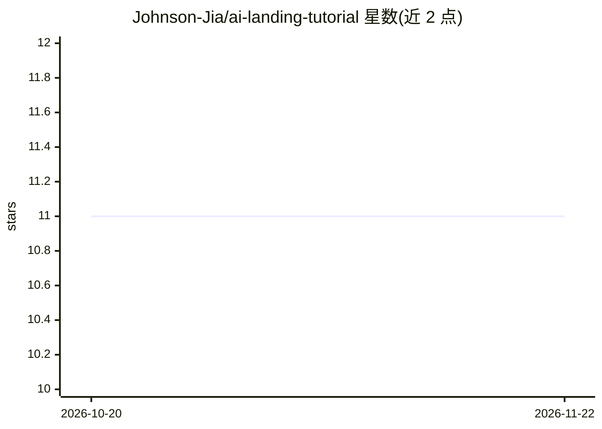

# Johnson-Jia/ai-landing-tutorial

⭐ 11 · HTML · MIT · 推送 2026-08-16 · [GitHub](https://github.com/Johnson-Jia/ai-landing-tutorial) · [官网](https://johnson-jia.github.io/ai-landing-tutorial/) · 个人维护 · 中文 README

**给技术负责人的企业 AI 转型方法论教程（7阶段+demo）**

一套企业级 AI 提效转型的结构化教程：将转型拆为 7 个可落地的阶段（思想总纲→战略启动→全员赋能→基础设施→试点→推广→沉淀复用），配套 HTML 教程页面、5 类角色操作手册、汇报材料模板与 10 个 demo 资产包（其中 3 个可直接运行，如自动化测试框架、代码度量、RAG 端到端）。另含面向 FDE 的番外篇与现场四件套。数据来自作者所在 80+ 人团队的事后统计，作者注明相关非因果。浏览器打开 index.html 即可使用，MIT 许可。

## 筛选速览

| 维度 | 判定 | 备注 |
|---|---|---|
| AI 角色 | `ai-knowledge` | 知识聚合/清单类 |
| 许可风险 | `permissive` | MIT |
| 部署形态 | `None` |  |
| 模型依赖 | — | README 未给出锁定关系 |
| 硬件要求 | — | 无带数字的原话,不猜 |
| 安装摩擦 | `low` | 无编译、无系统依赖或容器化 |
| 成熟度 | — | 结构信号不足 |

## 能力要点

- 7 阶段转型路线图，含每步的产出与工具说明
- 10 个 demo 与资产包，其中 3 个可直接运行
- 按角色（开发/测试/组长/产品/运营）分册的操作手册
- 汇报材料 Prompt 包与转型计划书模板

## 适用场景

- 带研发团队推动 AI 转型并向上汇报争取资源
- 按角色手册了解自己在转型期的职责与做法
- 复用度量 demo 统计团队 AI 代码占比等指标
- 准备转 FDE 并了解客户现场工作方法

## 场景标签

`教程课程` · 领域:学习与行业

## 证据(README 行号)

> L9: 一套**企业级 AI 提效战略转型的完整方法论教程**：把「拥抱 AI」这句口号，拆成 **7 个可落地、可度量、可复制的阶段**——总纲（思想+原理）→ 战略启动 → 全员赋能 → 基础设施 → 闭环试点 → 推广度量 → 沉淀复
> L18: 不只是讲道理——配套 **10 个 demo 与资产包**：3 个可直接运行（AI 自动化测试框架、AI 代码度量、AI RAG 端到端），其余拿来即用（汇报材料 Prompt 包、角色操作手册、Claude Code skill

## 星数曲线

2026-10-20 11 → 2026-11-22 11（+0）

---
*卡片 v1 · prompt 1.4 · 生成 2026-11-19 · 置信度 high · 依据 README sha `75ea1841b95b` · [字段定义](../../DATASET.md)*
