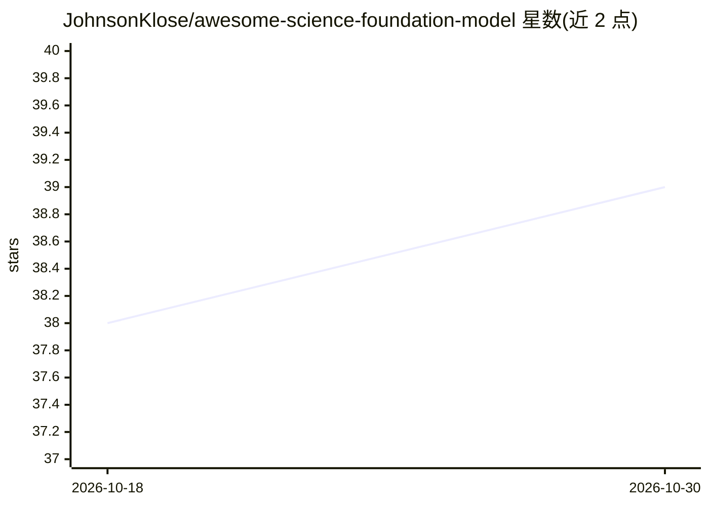

# JohnsonKlose/awesome-science-foundation-model

⭐ 39 · NOASSERTION · 推送 2026-06-17 · [GitHub](https://github.com/JohnsonKlose/awesome-science-foundation-model) · 个人维护 · 中文 README

**科学基础模型策展清单：1,000+ 模型覆盖 9 大领域**

双语（中英）的科学基础模型聚合清单：收录 1,000+ 模型，按生命科学、化学、物理、医学等 9 个领域、110+ 子方向组织。条目以表格呈现，含模型名、论文标题、描述与论文/来源链接，覆盖蛋白质语言模型、结构预测（AlphaFold 系列、RoseTTAFold 等）等方向，跨领域模型在适用处重复列出。面向需要按领域查找科学基础模型及其论文的研究者与开发者。

## 筛选速览

| 维度 | 判定 | 备注 |
|---|---|---|
| AI 角色 | `ai-knowledge` | 知识聚合/清单类 |
| 许可风险 | `none` | NOASSERTION |
| 部署形态 | `None` |  |
| 模型依赖 | — | README 未给出锁定关系 |
| 硬件要求 | — | 无带数字的原话,不猜 |
| 安装摩擦 | `low` | 无编译、无系统依赖或容器化 |
| 成熟度 | — | 结构信号不足 |

## 能力要点

- 1,000+ 模型条目覆盖 9 大领域、110+ 子方向
- 每条目给出模型名、论文标题、描述与来源链接
- 中英双语内容组织

## 适用场景

- 按子方向查找蛋白质等科学基础模型及其论文
- 调研 AI for Science 领域的模型覆盖情况
- 为科研选型收集候选模型清单

## 场景标签

`精选清单` · 领域:学习与行业

## 证据(README 行号)

> L11: *One map, every frontier — your starting point for 1,000+ AI-for-Science models.*
> L13: A comprehensive, bilingual (EN/ZH) guide to foundation models driving the next wave of scientific breakthroughs — *

## 星数曲线

2026-10-18 38 → 2026-10-30 39（+1）

---
*卡片 v1 · prompt 1.4 · 生成 2026-10-25 · 置信度 high · 依据 README sha `ec31744df17a` · [字段定义](../../DATASET.md)*
