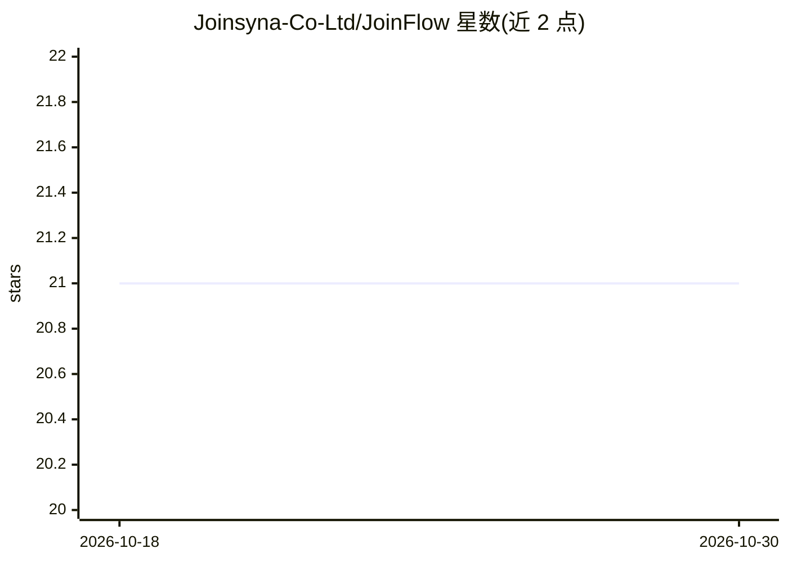

# Joinsyna-Co-Ltd/JoinFlow

⭐ 21 · Python · MIT · 推送 2026-01-15 · [GitHub](https://github.com/Joinsyna-Co-Ltd/JoinFlow) · [官网](https://www.joinsyna.com) · 组织维护 · 中文 README

**企业级多Agent自动化平台：任务执行、报告生成与RAG**

JoinFlow 是面向企业用户的多智能体自动化平台，内置 Browser/LLM/OS/Data/Vision/Code 六种 Agent，由智能编排器分析任务、选择 Agent 组合并汇总结果；覆盖网页浏览、数据分析、文件操作、报告生成等任务。支持知识库与 RAG 检索（Qdrant 向量库）、Cron 定时任务、工作流模板、语义相似度 LLM 缓存，并可导出 MD/PDF/Excel/PPT 等 7 种格式（PDF 支持中文）。多模型支持 OpenAI/Claude/DeepSeek/本地模型，可通过 Docker/K8s 私有化部署；MIT 许可。

## 筛选速览

| 维度 | 判定 | 备注 |
|---|---|---|
| AI 角色 | `ai-native` | 本体是模型或模型工具 |
| 许可风险 | `permissive` | MIT |
| 部署形态 | `self-host` | docker 或自建部署 |
| 模型依赖 | — | README 未给出锁定关系 |
| 硬件要求 | — | 无带数字的原话,不猜 |
| 安装摩擦 | `low` | 无编译、无系统依赖或容器化 |
| 成熟度 | — | 结构信号不足 |

## 能力要点

- 6 种专业 Agent 与智能编排器自动规划任务路径
- 知识库管理与 RAG 检索增强（Qdrant 向量索引）
- 7 种格式导出，PDF/Excel/PPT 支持中文
- Cron 定时任务与工作流模板，7×24 无人值守运行

## 适用场景

- 让多 Agent 自动完成网络调研并生成企业报告
- 搭建私有化部署的智能任务自动化与定时报告系统
- 上传企业文档建立知识库并做检索增强问答

## 场景标签

`多智能体` `工作流自动化` `RAG` · 领域:Agent 开发

## 证据(README 行号)

> L15: **JoinFlow** 是一个功能完整的 **企业级 AI Agent 自动化平台**，旨在通过多智能体协作实现复杂任务的自动化执行。无论是网络搜索、数据分析、文件操作还是报告生成，JoinFlow 都能智能规划并高效完成。
> L34: |**多 Agent 协作**|✅|Browser/LLM/OS/Data/Vision/Code 6种Agent|
> L42: |**多模型支持**|✅|OpenAI/Claude/DeepSeek/本地模型|

## 星数曲线

2026-10-18 21 → 2026-10-30 21（+0）

---
*卡片 v1 · prompt 1.4 · 生成 2026-10-28 · 置信度 high · 依据 README sha `30665cbf107f` · [字段定义](../../DATASET.md)*
